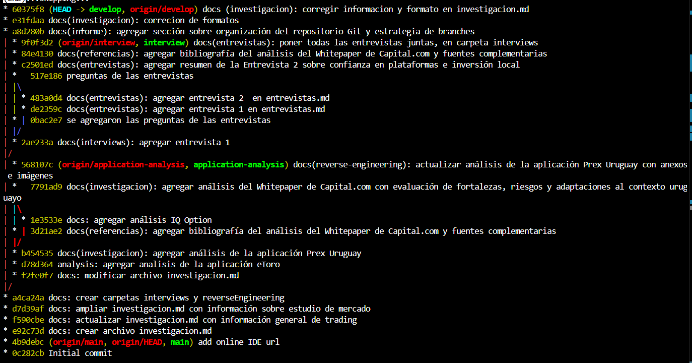

# Informe Académico 1

## Repositorio Git

### Organización del repositorio

El repositorio del proyecto se encuentra alojado en GitHub, bajo el nombre **`proyecto-m4c-carsin-costa`**.  
La estructura está organizada de forma modular, siguiendo una distribución de  documentación, código fuente y materiales de investigación.  
Las carpetas principales son:

- **`docs/`**: contiene toda la documentación académica y técnica del proyecto, incluyendo los informes, análisis de aplicaciones y bibliografía.  
  Dentro de esta carpeta se encuentran archivos como **informe_1.md**, **informe_2.md**,**informe_testing.md** y **investigacion.md**.

- **`interviews/`**: incluye los resúmenes de entrevistas realizadas a usuarios de otras aplicaciones de trading y a posibles futuros usuarios, fundamentales para la etapa de investigación de requisitos (analisis de mercado).

- **`reverseEngineering/`**: contiene los análisis comparativos y de ingeniería inversa de plataformas de inversión existentes (tales como, IQ Option, eToro y Prex Uruguay).

- **`src/`**: aloja el código fuente de la aplicación, dividido en subcarpetas por dominio (**domain/**), interfaz (**interface/**) y demás componentes lógicos.

- Archivos adicionales como `.gitignore`, `README.md`, `package.json`, `package-lock.json` y `eslint.config.js` se incluyen en la raíz para manejo de dependencias, configuración del entorno y control de estilo del código.

### Estructura de Ramas del Repositorio

El repositorio sigue una estructura de ramas pensada para mantener un flujo de trabajo ordenado y colaborativo.  

Desde la rama principal **`main`** se desprende **`develop`**, que funciona como el espacio donde se concentran todas las modificaciones, pruebas y mejoras que se van realizando a lo largo del proyecto. Es, en otras palabras, la versión en desarrollo que va evolucionando hasta llegar al resultado final. Una vez que el proyecto alcanza una versión estable y completa, los cambios de **develop** se integran nuevamente en **main**.  

A partir de **`develop`** se crean dos ramas secundarias:  

- **`interview`**: utilizada para cargar y documentar todo lo relacionado con las entrevistas realizadas, ya sea con potenciales usuarios o con personas que utilizan otras aplicaciones similares del mercado.  
- **`application-analysis`**: enfocada en recopilar y registrar los análisis e investigaciones de ingeniería reversa sobre plataformas existentes, permitiendo entender sus funcionalidades y usabilidad para tomar referencias en el desarrollo propio.  

Esta estructura permite mantener separadas las distintas líneas de trabajo —desarrollo, análisis e investigación de usuarios— evitando conflictos entre ramas y asegurando que cada aporte se integre de forma controlada y clara en el flujo general del proyecto.

---

### Pautas de commits

Se utiliza la convención **Conventional Commits**, lo que permite mantener un historial de cambios claro y legible.  
El formato adoptado es:

Ejemplos de commits realizados:

- `docs(entrevistas): agregar entrevista 2 en entrevistas.md`  
- `docs(investigacion): agregar análisis del Whitepaper de Capital.com`  
- `docs(referencias): agregar bibliografía del análisis del Whitepaper`  
- `analysis: agregar análisis de la aplicación eToro`

Los tipos más utilizados son:
- **`docs`**: cambios en documentación o archivos de análisis.  
- **`feat`**: incorporación de nuevas funcionalidades.  
- **`fix`**: correcciones o ajustes.  
- **`analysis`**: commits asociados al trabajo de investigación y análisis de mercado.  

Por este formato, el historial del proyecto mantiene coherencia y trazabilidad, facilitando tanto la revisión como la evaluación académica del trabajo.

---

### README del proyecto

El archivo **`README.md`** se encuentra en la raíz del repositorio y cumple una función informativa y organizativa.  
Incluye:

- **Título del proyecto:** *Proyecto 2025 S2*.  
- **Objetivo general:** desarrollar una aplicación de inversión enfocada en usuarios uruguayos.  
- **Descripción estructurada del repositorio**, especificando el propósito de cada carpeta (`docs`, `src`, etc.).  
- **Guía de entregas** con los nombres de los informes (`informe_1`, `informe_2`, `informe_testing`).  
- **Recursos adicionales:** enlace al enunciado del proyecto, rúbrica de evaluación y pautas de entrega.  
- **Instrucciones de instalación y uso del entorno**, así como la configuración de ESLint y dependencias npm.

El README sirve como **punto de entrada** tanto para el equipo como para los evaluadores, centralizando la información clave del repositorio y su documentación técnica.

---

# Métodos de investigación

Los métodos de investigación que utilizamos fueron: **entrevistas**, **análisis de documentos** e **ingeniería reversa**.

## Análisis de documentos

Los aspectos más importantes que encontramos en el análisis de documentos muestran que, en Uruguay, es ilegal operar sin un bróker, según la [Ley N.º 16906](https://www.impo.com.uy/bases/leyes/16906-1998) y lo establecido por el estudio contable [Borche & Asuaga](https://bac.com.uy/trading-en-uruguay/). Estos brókers son los encargados de ejecutar transacciones rápidas, cobrar comisiones, ofrecer cuentas demo, apalancamiento y diversas plataformas para operar de forma segura y regulada.

También vimos que la rentabilidad se calcula comparando valores iniciales y finales, mientras que el riesgo se gestiona mediante drawdown (caídas máximas), volatilidad y ratios riesgo/beneficio recomendables de 1:2 o superior. A la hora de evaluar el desempeño, métricas como el **Ratio de Sharpe** (donde valores mayores a 1 son positivos) y el **Ratio de Calmar** resultan fundamentales, tal como se explica en el curso de trading de [MVDtrading](https://www.mvdtrading.com/curso-trading-presencial-aw).

En cuanto a los beneficios fiscales, Uruguay ofrece una carga total del **0,96% sobre utilidades**, siempre que los bienes no ingresen físicamente al país, según [Borche & Asuaga](https://bac.com.uy/trading-en-uruguay/).

También entendimos que, a la hora de no solo invertir sino también diseñar una aplicación, la **psicología del trading** cumple un rol clave. Tal como menciona [IG](https://www.ig.com/es/estrategias-de-trading/las-7-emociones-a-controlar-en-el-trading-230518), controlar emociones como el miedo, la avaricia y la euforia, junto con sesgos cognitivos como el exceso de confianza, permite aplicar estrategias más seguras como el apalancamiento controlado, la diversificación y los *stop loss* que ayudan a limitar las pérdidas.

Por último, **Capital.com** propone un modelo FinTech transparente que utiliza inteligencia artificial para reducir los sesgos emocionales, aunque su implementación local requiere una adaptación regulatoria y tecnológica progresiva. Consideramos que, si bien es un concepto muy interesante, no es tan simple de llevar a cabo; por eso creemos que lo más importante es **mantener siempre claros los riesgos** y promover la educación financiera como base del desarrollo.

Un desarrollo más profundo de esta información se encuentra en **`investigacion.md`** dentro de la carpeta **docs**.

## Entrevistas

Aplicando el método de las entrevistas obtuvimos información valiosa, pues de esta manera conocimos cara a cara las dificultades y beneficios que tienen los traders al operar en este mercado.  
Las entrevistas se realizaron basándonos en una base de preguntas que se encuentran en **`Preguntas de entrevista.md`** dentro de la carpeta **interviews**.  

Se lograron concretar 3 entrevistas, dos con un experto y una con alguien fuera del ámbito.  
De las tres entrevistas realizadas, identificó varios puntos en común entre los participantes, más allá de su nivel de experiencia:

### Elementos compartidos por todos

Los tres coinciden en que la confianza y seguridad son fundamentales. Tanto el experto como el inversor que tuvo malas experiencias enfatizan la necesidad de regulación clara, preferentemente del Banco Central del Uruguay, y transparencia total en las operaciones. Los tres valoran que la plataforma sea rápida y fácil de usar, con una interfaz amigable e intuitiva que facilite la experiencia del usuario. Además, todos mencionan la importancia de la educación e información clara, ya sea mediante guías paso a paso, explicación de gráficos o alertas de noticias relevantes.

Un aspecto clave que surge es la flexibilidad en los métodos de verificación de seguridad. El usuario inexperto menciona específicamente la inconveniencia de las contraseñas largas y la doble autenticación constante, sugiriendo que sería ideal que la aplicación permita al usuario elegir entre diferentes métodos como huella digital, reconocimiento facial u otras opciones, según su preferencia personal.

### Aspecto destacado de la entrevista con el inversor experimentado

Un punto muy valioso que surge de la entrevista con el inversor que tuvo malas experiencias es su propuesta de garantizar al menos el capital inicial invertido, aunque se puedan perder las utilidades. Esta idea responde directamente al miedo generalizado a las estafas y podría ser un diferenciador clave para generar confianza en nuevos inversores. También sugiere enfocarse en inversiones locales tangibles -como construcción, ganado o forestación- y presentarse como "la plataforma de inversión de los uruguayos", aprovechando el sentido de identidad local como ventaja competitiva frente a plataformas internacionales.

Para conocer más sobre las entrevistas realizadas estas se encuentran en **entrevistas.md** dentro de la carpeta **interviews**. 

## Ingeniería reversa

Para complementar toda esta información obtenida también usamos el método de ingeniería reversa; para esto analizamos tres aplicaciones existentes en el mercado: **eToro**, **IQ Option** y **Prex**.  
Considerando un análisis comparativo de estas aplicaciones se sabe que:

### Puntos fuertes por plataforma

**Prex Uruguay:**  
- Fácil acceso con pesos uruguayos (sin necesidad de cuentas internacionales)  
- Respaldo del Banco Central de Uruguay - genera mayor confianza local  
- Mínimos de inversión bajos (desde USD 10) ideal para principiantes  
- Interfaz simple y educativa para quienes comienzan  
- <a href="https://sololosmejores.net/iqoption-libertex-latam">Fuentes : SoloLosMejores.net</a><a href="https://iq-option.com/lp/mobile/es/?aff=1&afftrack=GAD_LATAM_LA_ES_Brand_new_22386271874_c_174076722621_kwd-1247123479&utm_source=google&utm_medium=cpc&utm_campaign=1_LATAM_LA_ES_Brand_new&utm_adset=phrase&gclsrc=aw.ds&gad_source=1&gad_campaignid=22386271874&gbraid=0AAAAADM93Q79vW0apQs9JZejUadJw5Gqv&gclid=CjwKCAjwup3HBhAAEiwA7euZutI_HFigNoMsPE3n4a29buGoYBegRuF2UZRYlFXmj3IWqkfFIrH2zRoCU5oQAvD_BwE"> y Sitio oficial de iq option</a>

**IQ Option:**  
- Cuenta demo con USD 10,000 virtuales - excelente para practicar sin riesgo  
- Herramientas de análisis técnico completas (RSI, MACD, medias móviles)  
- Gráficos personalizables con múltiples indicadores y herramientas de dibujo  
- Múltiples instrumentos en una sola app (forex, criptos, acciones, commodities)  
- <a href="https://www.etoro.com/es/">Fuente: Sitio oficial de eToro</a>  <a href="https://www.youtube.com/watch?v=-yjKzscGeTs"> y  YouTube - Berciano</a>

**eToro:**  
- CopyTrading - permite copiar operaciones de traders exitosos  
- Interfaz moderna e intuitiva - muy amigable para principiantes  
- Comunidad activa y componente social del trading  
- eToro Academy - mejor contenido educativo integrado  
- Regulación sólida (FCA, CySEC, ASIC) - mayor seguridad  

Sin embargo no todo es bueno también hay **problemas comunes**:  
Demoras en retiros (especialmente IQ Option y eToro)  
Comisiones ocultas o poco claras (todas tienen este problema en algún aspecto)  
Falta de soporte personalizado - atención al cliente deficiente  
Curva de aprendizaje pronunciada para funciones avanzadas  

#### **Sacar lo mejor de todo**
Ante esto un buen inició de partida para el desarrollo de una nueva aplicación de trading para Uruguay sería:  
Implementar el CopyTrading de eToro combinado con la simplicidad de Prex  
Incluir cuenta demo robusta como IQ Option pero más realista  
Ofrecer herramientas técnicas avanzadas pero con interfaz gradual según experiencia  
Garantizar transparencia total en comisiones y procesos de retiro ágiles  
Mantener identidad local y regulación uruguaya como Prex pero con funcionalidad internacional  

La plataforma ideal tomaría la confianza institucional de Prex, las herramientas técnicas de IQ Option y la innovación social de eToro, adaptado al mercado uruguayo. *(estos no son los requisitos pero está bueno poner los pies en la tierra)*

El analisi de las aplicaciones se encuentra dentro de la carpeta reverseEngineering y dentro de esta encontrara los archivos:  **`analisis etoro.md`**,  **`analisis-IQ-Option.md`**, **`analisi-prex.md`**.

## Bibliografias
Berciano, E. (Director). (2025, March 16). Cómo Configurar STOPLOSS y TAKE PROFIT en ETORO para hacer SWING TRADING. https://www.youtube.com/watch?v=-yjKzscGeTs

como abrir una operacion en iq option - Google Search. (n.d.). Google.com. Retrieved October 7, 2025, from https://www.google.com/search?sca_esv=1ecdb2dd816d191e&sxsrf=AE3TifPrqGOsMXvwPyBrzQ3nc6FTMr6arw:1759775002243&udm=7&fbs=AIIjpHx4nJjfGojPVHhEACUHPiMQf-5E2B2fzLEKeWLyFzQTKceRtMrXpsj_Na9j6JAyaRgCOELN0KG6HnZhsi4unsbpAtNpApXWFglPZsYR2xlYT903z17GoYQKxVnswTo3-MxbeihWbVXmxKywR0qFfoOpc5vLMpbfgn2120mq8xn_c0-dUoEzg4z6aZEKEXCGtHPgIk0WY8NlM0gg5s-jZuxgDocmvA&q=como+abrir+una+operacion+en+iq+option&sa=X&ved=2ahUKEwiKwZLfmJCQAxUaP7kGHasiLg4QtKgLegQIFBAB&biw=1536&bih=730&dpr=1.25

Invierta con eToroTM. (n.d.). Etoro.com. Retrieved October 7, 2025, from https://www.etoro.com/es/

IQOption: Es un bróker confiable? (2023, November 19). Sololosmejores.net. https://sololosmejores.net/iqoption-libertex-latam/?gcam=586-820-9117&utm_source=solosmejores&utm_medium=cpc&utm_campaign=22470028496&campaignid=stocks&kw=account_000_solosmejores-586-820-9117_campaign_22470028496keywordiq%20optiondevicec&gad_source=1&gad_campaignid=22470028496&gbraid=0AAAAAo0A5n2qVwPrYeyIrCkbcVKXkrPt7&gclid=Cj0KCQjw0Y3HBhCxARIsAN7931WPYNLLHQStOxdKUQUPizNKrdXBHznCl0ylw3JGLRg1bhMin6nAOAoaAgVKEALw_wcB

Landing Presencial Curso Trading AW » 🎓 MVDtrading Academia de Inversiones. (2024, November 7). 🎓 MVDtrading Academia de Inversiones; MVDtrading 🎓. https://www.mvdtrading.com/curso-trading-presencial-aw/?campaignid=11435171645&adgroupid=111060982079&adid=474492905653&gad_source=1&gad_campaignid=11435171645&gbraid=0AAAAADh2uNLI6ocVlkKm-fXcGJtCOTnsZ&gclid=Cj0KCQjw0Y3HBhCxARIsAN7931VXiQkWu1q-xgiCKqALn0JApKtUvQ5WE-dANCKK8hPp3q_mC94Ma5caAkUTEALw_wcB

Ley N� 16906. (n.d.). Com.uy. Retrieved October 7, 2025, from https://www.impo.com.uy/bases/leyes/16906-1998

RÉGIMEN DE TRADING EN URUGUAY. (2023, August 2). Borche & Asuaga - Estudio Contable - BAC. https://bac.com.uy/trading-en-uruguay/

Torres, F. (2023, May 24). Las 7 emociones a controlar en el trading. IG. https://www.ig.com/es/estrategias-de-trading/las-7-emociones-a-controlar-en-el-trading-230518

---
# Requerimientos

## Requerimientos Funcionales (Lo que el sistema debe hacer)
1. Que el sistema permite visualizar una **lista actualizada de instrumentos financieros** (acciones, divisas, criptomonedas, commodities) con precios en tiempo real.    🟩
2. Que los usuarios puedan ejecutar operaciones de compra y venta en el mercado, eligiendo entre órdenes a mercado o con límites de precio. 🟩 
3. Que se ofrezca una **cuenta demo** con saldo virtual para practicar operaciones sin  riesgo, simulando condiciones reales.  🟨
4. Que el sistema muestre de forma clara y organizada el **historial de operaciones** de cada usuario, incluyendo datos de fecha, tipo, monto y resultado. 🟩
5. Que los usuarios puedan **consultar métricas de rentabilidad y riesgo** (Ej: drawdown, ratio Sharpe, ratio riesgo/beneficio).  🟩
6. Que la aplicación incluya una **sección educativa con guías**, artículos o videos sobre inversión responsable y psicología del trading.  🟨
7. Que el sistema envía **notificaciones al usuario sobre ejecuciones de órdenes, movimientos importantes del mercado o actualizaciones relevantes**.  🟨
8. Que el sistema cumpla con los **requisitos legales y de seguridad** exigidos por el **Banco Central del Uruguay y la Ley Nº 16.906**. 🟩 
9. Que el sistema permita a los usuarios **editar su perfil**, incluyendo preferencias de idioma, métodos de pago y configuración de seguridad.🟨
10. Que el sistema permita las **operaciones con múltiples monedas**..🟧
11. Que el sistema **muestre todas las comisiones aplicables** a cada operación y no oculte cargos adicionales.🟧
12. Que se incorporen **advertencias visibles y recurrentes** sobre los riesgos del trading.🟧

### Requerimientos No Funcionales (Como el sistema debe hacerlo)

13. Que la **interfaz sea intuitiva, clara y fácil de usar desde cualquier dispositivo **(computadora o móvil).🟩
14. Que las páginas o vistas principales **se acceden en menos de 5 clicks**. 🟨
15. Que las **operaciones** se hagan de **manera instantánea**. 🟩
16. Que el sistema funcione correctamente en los principales sistemas **Android/iOS y windows**.  🟩
17. Que el **código fuente** se mantenga modular, documentado y versionado en **GitHub**, facilitando su mantenibilidad.  🟩
18. Que el sistema **muestre las comisiones o costos antes de ejecutar cualquier transacción**.  🟧
19. Que el sistema pueda **soportar múltiples idiomas** y desarrollarse en principio en español e inglés   🟧
20. El sistema debe presentar colores verdes y rojos tanto en los botones (subir y bajar y/o compra y venta) como en las gráficas, para indicar si sube o baja una acción.🟥

Para realizar un mejor trabajo priorizamos los requisitos amplicando MoSCoW:

- 🟩Must have 
- 🟨Should have 
- 🟧Could have 
- 🟥Won’t have 

## User Persona

Para tener una mejor comprensión y validación del proyecto, realizamos varios *user persona* que representan diferentes perfiles de usuarios.  
Estos perfiles nos permitieron entender mejor sus necesidades, motivaciones y comportamientos, facilitando el diseño de una solución más adecuada.

 

# User Stories & Use Cases

El proyecto busca desarrollar una **aplicación de inversiones uruguaya** que permita a los usuarios **intercambiar valor** mediante compra y venta de activos (acciones, criptomonedas, etc.) sin depender de plataformas extranjeras.  
La solución apunta a ofrecer **simplicidad, transparencia y seguridad** en el mercado financiero digital local.

## User Stories (Historias de Usuario)

Cada historia se presenta siguiendo el formato estándar:

> **Como [actor], quiero [acción], para [beneficio].**

Además, se detallan los **criterios INVEST** (Independiente, Negociable, Valiosa, Estimable, Simple, Testeable) y su **prioridad MoSCoW**.

---

### Tabla de User Stories

| ID | Historia de Usuario | Prioridad | Criterios INVEST | Criterio de Aceptación |
|----|----------------------|------------|------------------|------------------------|
| **US1** | Como **usuario**, quiero **ver mi portafolio con gráficos y variaciones diarias** para **evaluar mi rendimiento total**. | 🟨 Should Have | ✅ I, V, E, S, T | Se muestra valor actual, variación diaria y un gráfico simple. |
| **US2** | Como **inversionista**, quiero **comprar o vender acciones y criptomonedas** para **operar de forma segura desde Uruguay**. | 🟩 Must Have | ✅ I, V, E, S, T | Puedo ejecutar operaciones y ver confirmación inmediata. |
| **US3** | Como **usuario**, quiero **recibir alertas cuando un activo sube o baja un porcentaje definido** para **tomar decisiones rápidas**. | 🟧 Could Have | ✅ I, N, V, E, T | Se envía notificación push al cumplirse el umbral configurado. |
| **US4** | Como **usuario nuevo**, quiero **acceder a una sección educativa básica** para **aprender antes de invertir.** | 🟨 Should Have | ✅ I, N, V, E, T | Se muestran artículos, videos y glosario básico. |
| **US5** | Como **inversionista avanzado**, quiero **descargar un reporte PDF de mis movimientos y ganancias** para **llevar control personal.** | 🟧 Could Have | ✅ I, N, V, E, T | Reporte con operaciones, fechas, montos y comisiones. |
| **US6** | Como **usuario**, quiero **ver advertencias claras sobre riesgos antes de invertir** para **entender la posibilidad de pérdida.** | 🟩 Must Have | ✅ I, V, T | Aparece mensaje de advertencia obligatorio antes de confirmar operación. |

---

## Priorización (MoSCoW)

| Tipo | Significado | Historias relacionadas |
|------|--------------|------------------------|
| 🟩 **Must Have** | Esenciales para el funcionamiento base | US1, US2, US4, US8 |
| 🟨 **Should Have** | Mejoran la experiencia del usuario | US3, US6 |
| 🟧 **Could Have** | Añaden valor complementario | US5, US7 |
| 🟥 **Won’t Have (por ahora)** | Ideas a futuro | Integración con ANII, simulador de rentabilidad |

---

## Use Cases (Casos de Uso)

Cada caso de uso describe **cómo interactúan los actores** con el sistema para lograr un objetivo concreto.  
Se detallan precondiciones, flujos principales y alternativos, postcondiciones y prioridad.

### **UC1 – Comprar activo**
**Actor:** Usuario autenticado  
**Precondición:** Tener saldo suficiente.  
**Flujo principal:**
1. El usuario selecciona un activo (acción o cripto).
2. Presiona “Comprar”.
3. Ingresa monto o cantidad.
4. El sistema calcula valor total y comisión.
5. El usuario confirma la compra.
6. El sistema ejecuta la orden y actualiza portafolio.

**Flujos alternativos:**
- Si no hay saldo → operación rechazada.  
- Si el mercado está cerrado → orden pendiente.

**Postcondición:** Activo registrado en portafolio.  
**Prioridad:** 🟩 Must Have

### **UC2 – Consultar portafolio**
**Actor:** Usuario autenticado  
**Precondición:** Tener inversiones activas.  
**Flujo principal:**
1. El usuario ingresa a “Mi portafolio”.
2. El sistema muestra lista de activos con su variación diaria.
3. Se genera gráfico de rendimiento.
4. El usuario puede filtrar por tipo de activo o rango de fechas.

**Flujo alternativo:**
- Si no hay inversiones → mostrar “No tenés activos todavía”.

**Postcondición:** Información actualizada mostrada correctamente.  
**Prioridad:** 🟨 Should Have

### **UC3 – Configurar alerta de precio**
**Actor:** Usuario autenticado  
**Precondición:** Tener al menos un activo en seguimiento.  
**Flujo principal:**
1. El usuario selecciona un activo.
2. Configura umbral de precio (subida o bajada).
3. El sistema guarda la alerta.
4. Si se cumple la condición → se envía notificación.

**Postcondición:** Alerta registrada correctamente.  
**Prioridad:** 🟧 Could Have

### **UC4 – Consultar portafolio**
**Actor:** Usuario autenticado  
**Precondición:** Tener inversiones activas.  
**Flujo principal:**
1. El usuario ingresa a “Mi portafolio”.
2. El sistema muestra lista de activos con su variación diaria.
3. Se genera gráfico de rendimiento.
4. El usuario puede filtrar por tipo de activo o rango de fechas.

**Flujo alternativo:**
- Si no hay inversiones → mostrar “No tenés activos todavía”.

**Postcondición:** Información actualizada mostrada correctamente.  
**Prioridad:** 🟧 Should Have

### **UC5 – Configurar alerta de precio**
**Actor:** Usuario autenticado  
**Precondición:** Tener al menos un activo en seguimiento.  
**Flujo principal:**
1. El usuario selecciona un activo.
2. Configura umbral de precio (subida o bajada).
3. El sistema guarda la alerta.
4. Si se cumple la condición → se envía notificación.

**Postcondición:** Alerta registrada correctamente.  
**Prioridad:** 🟨 Could Have

### **UC6 – Mostrar advertencias de riesgo antes de invertir**

**Actor:** Usuario autenticado  

**Precondición:**  
El usuario tiene saldo disponible e intenta realizar una operación (compra o venta) de un activo.

**Flujo principal:**
1. El usuario selecciona un activo y presiona **“Comprar”** o **“Vender”**.  
2. Antes de confirmar la operación, el sistema muestra un mensaje emergente con advertencias legales sobre el riesgo de pérdida de capital.  
3. El usuario debe **leer y aceptar** las condiciones para continuar.  
4. Si el usuario acepta, el sistema permite confirmar la transacción.  
5. La operación se ejecuta y se actualiza el portafolio.

**Flujos alternativos:**
- Si el usuario **no acepta** las advertencias → el sistema cancela la operación y vuelve a la pantalla anterior.  
- Si el usuario intenta operar repetidamente sin aceptar → se bloquea temporalmente la acción y se muestra un mensaje recordatorio.

**Postcondición:**  
El sistema registra que el usuario aceptó las advertencias de riesgo (fecha y hora).

**Prioridad:** 🟩 Must Have

---

Las **User Stories y Use Cases** que presentamos buscan reflejar de manera realista las necesidades y expectativas de los usuarios uruguayos que invertirán en la plataforma. Al aplicar los criterios **INVEST** y la priorización **MoSCoW**, logramos organizar el trabajo en etapas claras y alcanzables, enfocándonos primero en lo esencial y luego en mejoras que realmente suman valor.

Este enfoque nos ayudó a:
- Entender mejor qué espera cada usuario y cómo interactúa con la app.
- Definir escenarios concretos y fáciles de seguir, tanto para el equipo como para quienes evalúan el proyecto.
- Priorizar lo importante, evitando perder tiempo en detalles secundarios al principio.
- Planificar el desarrollo de forma flexible, adaptándonos a lo que vamos aprendiendo en cada iteración.

En resumen, este análisis no solo nos dio claridad sobre qué construir, sino que también nos permitió trabajar de manera más ordenada y alineada con las expectativas reales de los usuarios.

---

## Modelo de Dominio

* Presentar un **Modelo Entidad-Relación (MER)** o **diagrama UML de clases**.
* Definir los conceptos principales y sus relaciones.
* Explicar brevemente cada entidad/concepto.

## Diagrama UML
 

---

## Verificación y Validación

* **Verificación:** describir cómo comprobaron que los RF/RNF cumplen con lo especificado (revisiones, checklist, trazabilidad).
* **Validación:** actividades con usuarios (feedback de encuestas, entrevistas, prototipos).
* Mostrar resultados obtenidos y cómo influyeron en futuras mejoras al proyecto.

Para verificar el cumplimiento de los requisitos funcionales (RF) y no funcionales (RNF), realizamos una revisión cruzada entre los requisitos definidos y las pantallas del prototipo.
Se elaboró una checklist de trazabilidad donde cada requisito fue marcado como implementado, parcialmente implementado o pendiente.
Esto nos permitió comprobar que el prototipo refleja correctamente lo establecido en el análisis y diseño.
## Prototipos 
Los prototipos realizados para una mejor implementacion de la aplicacion fueron:

    

## Verificación

## Validación
El prototipo se desarrolló con el propósito de bajar a tierra el proyecto y visualizar de forma concreta cómo se integrarían los diferentes requisitos dentro del sistema. A través del diseño de las distintas pantallas se buscó representar las funcionalidades principales y ordenar la información según las necesidades identificadas de los usuarios, permitiendo evaluar la coherencia general del flujo y la distribución de los elementos.
Durante la construcción del prototipo se fueron identificando detalles y ausencias que no habían sido contempladas en las etapas iniciales, como la necesidad de mostrar el modo de cuenta (demo o real) de forma más visible, la inclusión de indicadores de saldo disponible y la mejora en la agrupación de botones de acción. A base de esto se permitieron realizar ajustes tanto en la organización visual como en la definición de algunos requisitos funcionales que se reformularon para lograr una mayor claridad.

## Descripción del Trabajo Individual de cada Integrannte

### Romina Carsin
| Fecha | Actividad | Horas invertidas |
|:------:|:----------:|:----------------:|
| 06/10 | Estructura del repositorio | 2h |
| 10/10, 9/10, 06/10 | Investigación de Información | 6h |
| 04/10, 03/10 | Entrevistas | 9h |
| 06/10, 05/10 | Ingeniería Reversa | 8h |
| 07/10 | Requerimientos | 5h |
| 13/10, 09/10 | User Persona | 3h |
| 14/10 | User Stories & Use Cases | 1h |
| 14/10 | Modelo del Dominio | 1h |
| 14/10, 13/10 | Verificación y Validación | 5h |

### Guzmán Costa

| Fecha | Actividad | Horas invertidas |
|:------:|:----------:|:----------------:|
| 06/10 | Estructura del repositorio | 7h |
| 10/10, 9/10, 06/10 | Investigación de Información | 3h |
| 04/10, 03/10 | Entrevistas | 5h |
| 06/10, 05/10 | Ingeniería Reversa | 6h |
| 07/10 | Requerimientos | 2h |
| 13/10, 09/10 | User Persona | 5h |
| 14/10 | User Stories & Use Cases | 4h |
| 14/10 | Modelo del Dominio | 4h |
| 14/10, 13/10 | Verificación y Validación | 1h |

---

### Resumen General

| Nombre | Horas trabajadas | Entrevistas Realizadas | Aplicaciones Analizadas |
|:-------:|:----------------:|:----------------------:|:-----------------------:|
| Romina Carsin | 40h | 2 | 2 |
| Guzmán Costa | 37h | 1 | 1 |

---

## Reflexión

* Reflexionar como equipo sobre:

  * Dinámica de trabajo y comunicación.
  * Dificultades y desafíos encontrados.
  * Qué funcionó bien y qué no.
  * Lecciones aprendidas hasta ahora.
* Mantener un tono crítico y constructivo, no sólo descriptivo

