# Informe Académico 1

## Repositorio Git

### Organización del repositorio

El repositorio del proyecto se encuentra alojado en GitHub, bajo el nombre **`proyecto-m4c-carsin-costa`**.  
La estructura está organizada de forma modular, siguiendo una distribución de  documentación, código fuente y materiales de investigación.  
Las carpetas principales son:

- **`docs/`**: contiene toda la documentación académica y técnica del proyecto, incluyendo los informes, análisis de aplicaciones y bibliografía.  
  Dentro de esta carpeta se encuentran archivos como **informe_1.md**, **informe_2.md**,**informe_testing.md** y **investigacion.md**.

- **`interviews/`**: incluye los resúmenes de entrevistas realizadas a usuarios de otras aplicaciones de trading y a posibles futuros usuarios, fundamentales para la etapa de investigación de requisitos (analisis de mercado).

- **`reverseEngineering/`**: contiene los análisis comparativos y de ingeniería inversa de plataformas de inversión existentes (tales como, IQ Option, eToro y Prex Uruguay).

- **`src/`**: aloja el código fuente de la aplicación, dividido en subcarpetas por dominio (**domain/**), interfaz (**interface/**) y demás componentes lógicos.

- Archivos adicionales como `.gitignore`, `README.md`, `package.json`, `package-lock.json` y `eslint.config.js` se incluyen en la raíz para manejo de dependencias, configuración del entorno y control de estilo del código.

### Estructura de Ramas del Repositorio

El repositorio sigue una estructura de ramas pensada para mantener un flujo de trabajo ordenado y colaborativo.  

Desde la rama principal **`main`** se desprende **`develop`**, que funciona como el espacio donde se concentran todas las modificaciones, pruebas y mejoras que se van realizando a lo largo del proyecto. Es, en otras palabras, la versión en desarrollo que va evolucionando hasta llegar al resultado final. Una vez que el proyecto alcanza una versión estable y completa, los cambios de **develop** se integran nuevamente en **main**.  

A partir de **`develop`** se crean dos ramas secundarias:  

- **`interview`**: utilizada para cargar y documentar todo lo relacionado con las entrevistas realizadas, ya sea con potenciales usuarios o con personas que utilizan otras aplicaciones similares del mercado.  
- **`application-analysis`**: enfocada en recopilar y registrar los análisis e investigaciones de ingeniería reversa sobre plataformas existentes, permitiendo entender sus funcionalidades y usabilidad para tomar referencias en el desarrollo propio.  

Esta estructura permite mantener separadas las distintas líneas de trabajo —desarrollo, análisis e investigación de usuarios— evitando conflictos entre ramas y asegurando que cada aporte se integre de forma controlada y clara en el flujo general del proyecto.

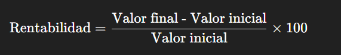

---

### Pautas de commits

Se utiliza la convención **Conventional Commits**, lo que permite mantener un historial de cambios claro y legible.  
El formato adoptado es:

Ejemplos de commits realizados:

- `docs(entrevistas): agregar entrevista 2 en entrevistas.md`  
- `docs(investigacion): agregar análisis del Whitepaper de Capital.com`  
- `docs(referencias): agregar bibliografía del análisis del Whitepaper`  
- `analysis: agregar análisis de la aplicación eToro`

Los tipos más utilizados son:
- **`docs`**: cambios en documentación o archivos de análisis.  
- **`feat`**: incorporación de nuevas funcionalidades.  
- **`fix`**: correcciones o ajustes.  
- **`analysis`**: commits asociados al trabajo de investigación y análisis de mercado.  

Por este formato, el historial del proyecto mantiene coherencia y trazabilidad, facilitando tanto la revisión como la evaluación académica del trabajo.

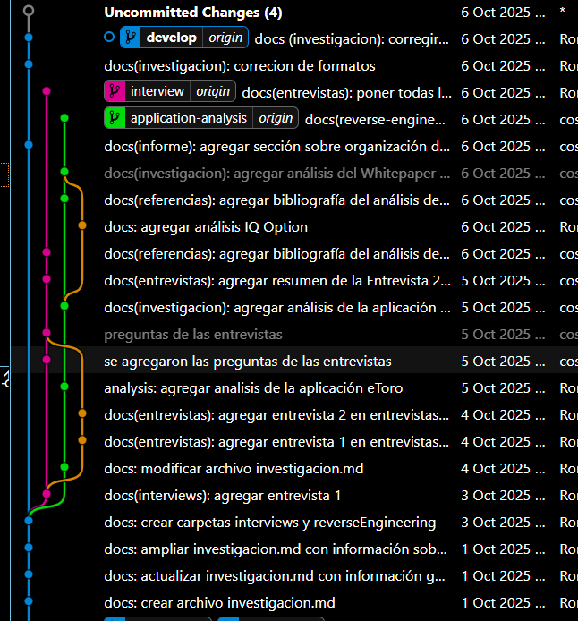

---

### README del proyecto

El archivo **`README.md`** se encuentra en la raíz del repositorio y cumple una función informativa y organizativa.  
Incluye:

- **Título del proyecto:** *Proyecto 2025 S2*.  
- **Objetivo general:** desarrollar una aplicación de inversión enfocada en usuarios uruguayos.  
- **Descripción estructurada del repositorio**, especificando el propósito de cada carpeta (`docs`, `src`, etc.).  
- **Guía de entregas** con los nombres de los informes (`informe_1`, `informe_2`, `informe_testing`).  
- **Recursos adicionales:** enlace al enunciado del proyecto, rúbrica de evaluación y pautas de entrega.  
- **Instrucciones de instalación y uso del entorno**, así como la configuración de ESLint y dependencias npm.

El README sirve como **punto de entrada** tanto para el equipo como para los evaluadores, centralizando la información clave del repositorio y su documentación técnica.

---

# Métodos de investigación

Los métodos de investigación que utilizamos fueron: **entrevistas**, **análisis de documentos** e **ingeniería reversa**.

## Análisis de documentos

Los aspectos más importantes que encontramos en el análisis de documentos muestran que, en Uruguay, es ilegal operar sin un bróker, según la [Ley N.º 16906](https://www.impo.com.uy/bases/leyes/16906-1998) y lo establecido por el estudio contable [Borche & Asuaga](https://bac.com.uy/trading-en-uruguay/). Estos brókers son los encargados de ejecutar transacciones rápidas, cobrar comisiones, ofrecer cuentas demo, apalancamiento y diversas plataformas para operar de forma segura y regulada.

También vimos que la rentabilidad se calcula comparando valores iniciales y finales, mientras que el riesgo se gestiona mediante drawdown (caídas máximas), volatilidad y ratios riesgo/beneficio recomendables de 1:2 o superior. A la hora de evaluar el desempeño, métricas como el **Ratio de Sharpe** (donde valores mayores a 1 son positivos) y el **Ratio de Calmar** resultan fundamentales, tal como se explica en el curso de trading de [MVDtrading](https://www.mvdtrading.com/curso-trading-presencial-aw).

En cuanto a los beneficios fiscales, Uruguay ofrece una carga total del **0,96% sobre utilidades**, siempre que los bienes no ingresen físicamente al país, según [Borche & Asuaga](https://bac.com.uy/trading-en-uruguay/).

También entendimos que, a la hora de no solo invertir sino también diseñar una aplicación, la **psicología del trading** cumple un rol clave. Tal como menciona [IG](https://www.ig.com/es/estrategias-de-trading/las-7-emociones-a-controlar-en-el-trading-230518), controlar emociones como el miedo, la avaricia y la euforia, junto con sesgos cognitivos como el exceso de confianza, permite aplicar estrategias más seguras como el apalancamiento controlado, la diversificación y los *stop loss* que ayudan a limitar las pérdidas.

Por último, **Capital.com** propone un modelo FinTech transparente que utiliza inteligencia artificial para reducir los sesgos emocionales, aunque su implementación local requiere una adaptación regulatoria y tecnológica progresiva. Consideramos que, si bien es un concepto muy interesante, no es tan simple de llevar a cabo; por eso creemos que lo más importante es **mantener siempre claros los riesgos** y promover la educación financiera como base del desarrollo.

Un desarrollo más profundo de esta información se encuentra en [**`investigacion.md`**](investigacion.md) dentro de la carpeta **docs**.

## Entrevistas

Aplicando el método de las entrevistas obtuvimos información valiosa, pues de esta manera conocimos cara a cara las dificultades y beneficios que tienen los traders al operar en este mercado.  
Las entrevistas se realizaron basándonos en una base de preguntas que se encuentran en [**`Preguntas de entrevista.md`**](/interviews/Preguntas%20de%20entrevista.md) dentro de la carpeta **interviews**.  

Se lograron concretar 3 entrevistas, dos con un experto y una con alguien fuera del ámbito.  
De las tres entrevistas realizadas, identificó varios puntos en común entre los participantes, más allá de su nivel de experiencia:

### Elementos compartidos por todos

Los tres coinciden en que la confianza y seguridad son fundamentales. Tanto el experto como el inversor que tuvo malas experiencias enfatizan la necesidad de regulación clara, preferentemente del Banco Central del Uruguay, y transparencia total en las operaciones. Los tres valoran que la plataforma sea rápida y fácil de usar, con una interfaz amigable e intuitiva que facilite la experiencia del usuario. Además, todos mencionan la importancia de la educación e información clara, ya sea mediante guías paso a paso, explicación de gráficos o alertas de noticias relevantes.

Un aspecto clave que surge es la flexibilidad en los métodos de verificación de seguridad. El usuario inexperto menciona específicamente la inconveniencia de las contraseñas largas y la doble autenticación constante, sugiriendo que sería ideal que la aplicación permita al usuario elegir entre diferentes métodos como huella digital, reconocimiento facial u otras opciones, según su preferencia personal.

### Aspecto destacado de la entrevista con el inversor experimentado

Un punto muy valioso que surge de la entrevista con el inversor que tuvo malas experiencias es su propuesta de garantizar al menos el capital inicial invertido, aunque se puedan perder las utilidades. Esta idea responde directamente al miedo generalizado a las estafas y podría ser un diferenciador clave para generar confianza en nuevos inversores. También sugiere enfocarse en inversiones locales tangibles -como construcción, ganado o forestación- y presentarse como "la plataforma de inversión de los uruguayos", aprovechando el sentido de identidad local como ventaja competitiva frente a plataformas internacionales.

Para conocer más sobre las entrevistas realizadas estas se encuentran en **entrevistas.md** dentro de la carpeta **interviews**. 

## Ingeniería reversa

Para complementar toda esta información obtenida también usamos el método de ingeniería reversa; para esto analizamos tres aplicaciones existentes en el mercado: **eToro**, **IQ Option** y **Prex**.  
Considerando un análisis comparativo de estas aplicaciones se sabe que:

### Puntos fuertes por plataforma

**Prex Uruguay:**  
- Fácil acceso con pesos uruguayos (sin necesidad de cuentas internacionales)  
- Respaldo del Banco Central de Uruguay - genera mayor confianza local  
- Mínimos de inversión bajos (desde USD 10) ideal para principiantes  
- Interfaz simple y educativa para quienes comienzan  
- <a href="https://sololosmejores.net/iqoption-libertex-latam">Fuentes : SoloLosMejores.net</a><a href="https://iq-option.com/lp/mobile/es/?aff=1&afftrack=GAD_LATAM_LA_ES_Brand_new_22386271874_c_174076722621_kwd-1247123479&utm_source=google&utm_medium=cpc&utm_campaign=1_LATAM_LA_ES_Brand_new&utm_adset=phrase&gclsrc=aw.ds&gad_source=1&gad_campaignid=22386271874&gbraid=0AAAAADM93Q79vW0apQs9JZejUadJw5Gqv&gclid=CjwKCAjwup3HBhAAEiwA7euZutI_HFigNoMsPE3n4a29buGoYBegRuF2UZRYlFXmj3IWqkfFIrH2zRoCU5oQAvD_BwE"> y Sitio oficial de iq option</a>

**IQ Option:**  
- Cuenta demo con USD 10,000 virtuales - excelente para practicar sin riesgo  
- Herramientas de análisis técnico completas (RSI, MACD, medias móviles)  
- Gráficos personalizables con múltiples indicadores y herramientas de dibujo  
- Múltiples instrumentos en una sola app (forex, criptos, acciones, commodities)  
- <a href="https://www.etoro.com/es/">Fuente: Sitio oficial de eToro</a>  <a href="https://www.youtube.com/watch?v=-yjKzscGeTs"> y  YouTube - Berciano</a>

**eToro:**  
- CopyTrading - permite copiar operaciones de traders exitosos  
- Interfaz moderna e intuitiva - muy amigable para principiantes  
- Comunidad activa y componente social del trading  
- eToro Academy - mejor contenido educativo integrado  
- Regulación sólida (FCA, CySEC, ASIC) - mayor seguridad  

Sin embargo no todo es bueno también hay **problemas comunes**:  
Demoras en retiros (especialmente IQ Option y eToro)  
Comisiones ocultas o poco claras (todas tienen este problema en algún aspecto)  
Falta de soporte personalizado - atención al cliente deficiente  
Curva de aprendizaje pronunciada para funciones avanzadas  

#### **Sacar lo mejor de todo**
Ante esto un buen inició de partida para el desarrollo de una nueva aplicación de trading para Uruguay sería:  
Implementar el CopyTrading de eToro combinado con la simplicidad de Prex  
Incluir cuenta demo robusta como IQ Option pero más realista  
Ofrecer herramientas técnicas avanzadas pero con interfaz gradual según experiencia  
Garantizar transparencia total en comisiones y procesos de retiro ágiles  
Mantener identidad local y regulación uruguaya como Prex pero con funcionalidad internacional  

La plataforma ideal tomaría la confianza institucional de Prex, las herramientas técnicas de IQ Option y la innovación social de eToro, adaptado al mercado uruguayo. *(estos no son los requisitos pero está bueno poner los pies en la tierra)*

El analisi de las aplicaciones se encuentra dentro de la carpeta reverseEngineering y dentro de esta encontrara los archivos: [**`analisis etoro.md`**](/reverseEngineering/analisis%20etoro.md), [**`analisis-IQ-Option.md`**](/reverseEngineering/analisis-IQ-Option.md), [**`analisis-prex.md`**](/reverseEngineering/analisis-prex.md).

## Bibliografias
Berciano, E. (Director). (2025, March 16). Cómo Configurar STOPLOSS y TAKE PROFIT en ETORO para hacer SWING TRADING. https://www.youtube.com/watch?v=-yjKzscGeTs

como abrir una operacion en iq option - Google Search. (n.d.). Google.com. Retrieved October 7, 2025, from https://www.google.com/search?sca_esv=1ecdb2dd816d191e&sxsrf=AE3TifPrqGOsMXvwPyBrzQ3nc6FTMr6arw:1759775002243&udm=7&fbs=AIIjpHx4nJjfGojPVHhEACUHPiMQf-5E2B2fzLEKeWLyFzQTKceRtMrXpsj_Na9j6JAyaRgCOELN0KG6HnZhsi4unsbpAtNpApXWFglPZsYR2xlYT903z17GoYQKxVnswTo3-MxbeihWbVXmxKywR0qFfoOpc5vLMpbfgn2120mq8xn_c0-dUoEzg4z6aZEKEXCGtHPgIk0WY8NlM0gg5s-jZuxgDocmvA&q=como+abrir+una+operacion+en+iq+option&sa=X&ved=2ahUKEwiKwZLfmJCQAxUaP7kGHasiLg4QtKgLegQIFBAB&biw=1536&bih=730&dpr=1.25

Invierta con eToroTM. (n.d.). Etoro.com. Retrieved October 7, 2025, from https://www.etoro.com/es/

IQOption: Es un bróker confiable? (2023, November 19). Sololosmejores.net. https://sololosmejores.net/iqoption-libertex-latam/?gcam=586-820-9117&utm_source=solosmejores&utm_medium=cpc&utm_campaign=22470028496&campaignid=stocks&kw=account_000_solosmejores-586-820-9117_campaign_22470028496keywordiq%20optiondevicec&gad_source=1&gad_campaignid=22470028496&gbraid=0AAAAAo0A5n2qVwPrYeyIrCkbcVKXkrPt7&gclid=Cj0KCQjw0Y3HBhCxARIsAN7931WPYNLLHQStOxdKUQUPizNKrdXBHznCl0ylw3JGLRg1bhMin6nAOAoaAgVKEALw_wcB

Landing Presencial Curso Trading AW » 🎓 MVDtrading Academia de Inversiones. (2024, November 7). 🎓 MVDtrading Academia de Inversiones; MVDtrading 🎓. https://www.mvdtrading.com/curso-trading-presencial-aw/?campaignid=11435171645&adgroupid=111060982079&adid=474492905653&gad_source=1&gad_campaignid=11435171645&gbraid=0AAAAADh2uNLI6ocVlkKm-fXcGJtCOTnsZ&gclid=Cj0KCQjw0Y3HBhCxARIsAN7931VXiQkWu1q-xgiCKqALn0JApKtUvQ5WE-dANCKK8hPp3q_mC94Ma5caAkUTEALw_wcB

Ley N� 16906. (n.d.). Com.uy. Retrieved October 7, 2025, from https://www.impo.com.uy/bases/leyes/16906-1998

RÉGIMEN DE TRADING EN URUGUAY. (2023, August 2). Borche & Asuaga - Estudio Contable - BAC. https://bac.com.uy/trading-en-uruguay/

Torres, F. (2023, May 24). Las 7 emociones a controlar en el trading. IG. https://www.ig.com/es/estrategias-de-trading/las-7-emociones-a-controlar-en-el-trading-230518

---
# Requerimientos

## Requerimientos Funcionales (Lo que el sistema debe hacer)
1. Que el sistema permite visualizar una **lista actualizada de instrumentos financieros** (acciones, divisas, criptomonedas, commodities) con precios en tiempo real.    
M 

2. Que los usuarios puedan ejecutar operaciones de compra y venta en el mercado, eligiendo entre órdenes a mercado o con límites de precio. 
M 
 
3. Que se ofrezca una **cuenta demo** con saldo virtual para practicar operaciones sin  riesgo, simulando condiciones reales.  
S 

4. Que el sistema muestre de forma clara y organizada el **historial de operaciones** de cada usuario, incluyendo datos de fecha, tipo, monto y resultado.  
M 

5. Que los usuarios puedan **consultar métricas de rentabilidad y riesgo** (Ej: drawdown, ratio Sharpe, ratio riesgo/beneficio).  
M 

6. Que la aplicación incluya una **sección educativa con guías**, artículos o videos sobre inversión responsable y psicología del trading.  
S 

7. Que el sistema envía **notificaciones al usuario sobre ejecuciones de órdenes, movimientos importantes del mercado o actualizaciones relevantes**.  
S 

8. Que el sistema cumpla con los **requisitos legales y de seguridad** exigidos por el **Banco Central del Uruguay y la Ley Nº 16.906**. 
M 
 
9. Que el sistema permita a los usuarios **editar su perfil**, incluyendo preferencias de idioma, métodos de pago y configuración de seguridad.
S 

10. Que el sistema permita las **operaciones con múltiples monedas**..
C 

11. Que el sistema **muestre todas las comisiones aplicables** a cada operación y no oculte cargos adicionales.
C 

12. Que se incorporen **advertencias visibles y recurrentes** sobre los riesgos del trading.
C 

## Requerimientos No Funcionales (Como el sistema debe hacerlo)

13. Que la **interfaz sea intuitiva, clara y fácil de usar desde cualquier dispositivo **(computadora o móvil).
M 

14. Que las páginas o vistas principales **se acceden en menos de 5 clicks**. 
S 

15. Que las **operaciones** se hagan de **manera instantánea**. 
M 

16. Que el sistema funcione correctamente en los principales sistemas **Android/iOS y windows**.  
M 

17. Que el **código fuente** se mantenga modular, documentado y versionado en **GitHub**, facilitando su mantenibilidad.  
M 

18. Que el sistema **muestre las comisiones o costos antes de ejecutar cualquier transacción**.  
C 

19. Que el sistema pueda **soportar múltiples idiomas** y desarrollarse en principio en español e inglés   
C 

20. El sistema debe presentar colores verdes y rojos tanto en los botones (subir y bajar y/o compra y venta) como en las gráficas, para indicar si sube o baja una acción.
W 

Para realizar un mejor trabajo priorizamos los requisitos amplicando MoSCoW:

M – Must have 

S – Should have 

C – Could have 

W – Won’t have

## User Persona

Para tener una mejor comprensión y validación del proyecto, realizamos varios *user persona* que representan diferentes perfiles de usuarios.  
Estos perfiles nos permitieron entender mejor sus necesidades, motivaciones y comportamientos, facilitando el diseño de una solución más adecuada.

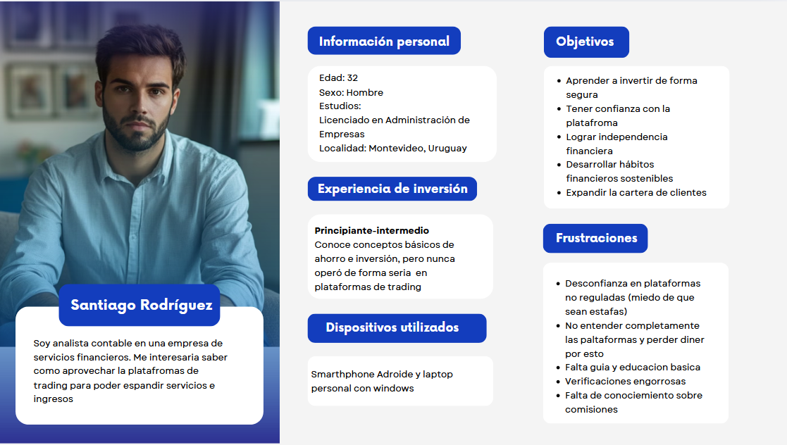 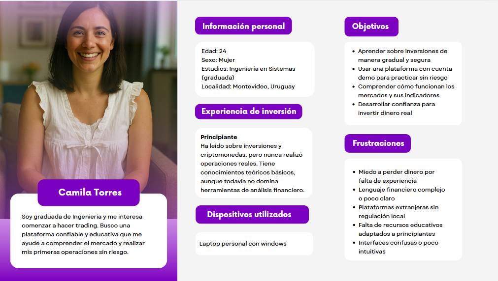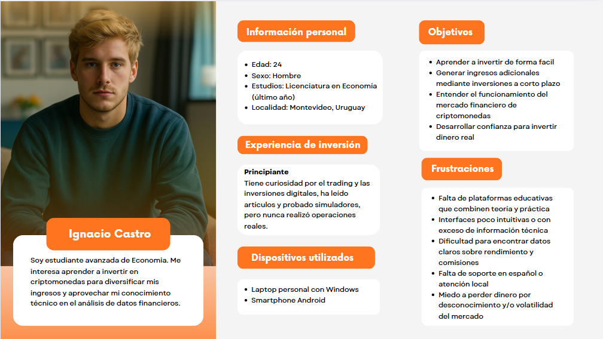

# User Stories & Use Cases

El proyecto busca desarrollar una **aplicación de inversiones uruguaya** que permita a los usuarios **intercambiar valor** mediante compra y venta de activos (acciones, criptomonedas, etc.) sin depender de plataformas extranjeras.  
La solución apunta a ofrecer **simplicidad, transparencia y seguridad** en el mercado financiero digital local.

## User Stories (Historias de Usuario)

Cada historia se presenta siguiendo el formato estándar:

> **Como [actor], quiero [acción], para [beneficio].**

Además, se detallan los **criterios INVEST** (Independiente, Negociable, Valiosa, Estimable, Simple, Testeable) y su **prioridad MoSCoW**.

---

### Tabla de User Stories

| ID | Historia de Usuario | Prioridad | Criterios INVEST | Criterio de Aceptación |
|----|----------------------|------------|------------------|------------------------|
| **US1** | Como **usuario**, quiero **ver mi portafolio con gráficos y variaciones diarias** para **evaluar mi rendimiento total**. | **
Should have 
**|  I, V, E, S, T | Se muestra valor actual, variación diaria y un gráfico simple. |
| **US2** | Como **inversionista**, quiero **comprar o vender acciones y criptomonedas** para **operar de forma segura desde Uruguay**. | **
Must have 
**| I, V, E, S, T | Puedo ejecutar operaciones y ver confirmación inmediata. |
| **US3** | Como **usuario**, quiero **recibir alertas cuando un activo sube o baja un porcentaje definido** para **tomar decisiones rápidas**. | **
Could have 
** | I, N, V, E, T | Se envía notificación push al cumplirse el umbral configurado. |
| **US4** | Como **usuario nuevo**, quiero **acceder a una sección educativa básica** para **aprender antes de invertir.** | **
Should have 
** |  I, N, V, E, T | Se muestran artículos, videos y glosario básico. |
| **US5** | Como **inversionista avanzado**, quiero **descargar un reporte PDF de mis movimientos y ganancias** para **llevar control personal.** | **
Could have 
** | I, N, V, E, T | Reporte con operaciones, fechas, montos y comisiones. |
| **US6** | Como **usuario**, quiero **ver advertencias claras sobre riesgos antes de invertir** para **entender la posibilidad de pérdida.** | **
Should have 
** |  I, V, T | Aparece mensaje de advertencia obligatorio antes de confirmar operación. |

---

### Priorización (MoSCoW)

| Tipo | Significado 
|------|--------------
| **
Must have 
**| Esenciales para el funcionamiento base | 
| **
Should have 
** | Mejoran la experiencia del usuario |
| **
Could have 
** | Añaden valor complementario |
| **
Won’t have
** | Ideas a futuro | 

## Use Cases (Casos de Uso)

 El desarrollo de los **casos de uso** se encuentra detallado en el documento [UseCases](UseCases.md).

# Modelo de Dominio

# Dominio del Sistema – TradeUy

**TradeUy** se enmarca dentro del dominio de las plataformas de inversión y educación financiera digital, pensada especialmente para usuarios de **Uruguay**.  
El objetivo principal del sistema es brindar un espacio accesible y seguro donde las personas puedan **invertir, analizar el mercado y gestionar su portafolio de activos financieros**, todo desde una misma aplicación web.

El sistema busca simplificar el acceso al mundo de las inversiones, ofreciendo tanto herramientas para usuarios con experiencia como una **cuenta demo** para quienes recién empiezan. Además, incluye una **sección educativa**, donde se pueden consultar artículos, videos y recursos que ayudan a entender los conceptos básicos antes de invertir dinero real.

Dentro del dominio, TradeUy cubre distintos procesos y elementos típicos del ámbito financiero, como la **compra y venta de activos** (acciones, criptomonedas, bonos o divisas), el **seguimiento de precios**, la **gestión de fondos en distintas monedas** y la **generación de reportes con métricas de rentabilidad**.  
También contempla la parte regulatoria: los usuarios deben validar su identidad y métodos de pago, cumpliendo con las normas del **Banco Central del Uruguay (BCU)**. Antes de ejecutar una operación, el sistema muestra advertencias sobre los posibles riesgos, fomentando una inversión responsable.

## Entidades principales del dominio

- **Usuario:** representa a la persona registrada en la plataforma. Puede operar con activos, usar la cuenta demo o acceder a contenido educativo.
- **Cuenta:** refleja los fondos del usuario, permitiendo hacer depósitos, retiros y operaciones en diferentes monedas.
- **Activo:** son los instrumentos financieros disponibles, como acciones, criptomonedas o bonos, con su precio actualizado en tiempo real.
- **Transacción:** modela cada operación de compra o venta, guardando datos como monto, fecha y comisión.
- **Portafolio:** agrupa los activos del usuario y muestra el rendimiento total e histórico.
- **Alerta:** permite configurar notificaciones cuando un activo cambia de precio o se cumplen ciertos umbrales.
- **ContenidoEducativo:** almacena los materiales disponibles para aprender sobre inversión y finanzas personales.
- **Comisión:** define los costos asociados a las operaciones según su tipo o monto.
- **Reporte:** genera documentos descargables con un resumen de las ganancias, pérdidas y movimientos.
- **ConfiguraciónUsuario:** guarda las preferencias personales, idioma, validaciones y tipos de notificación elegidos.

## Diagrama UML
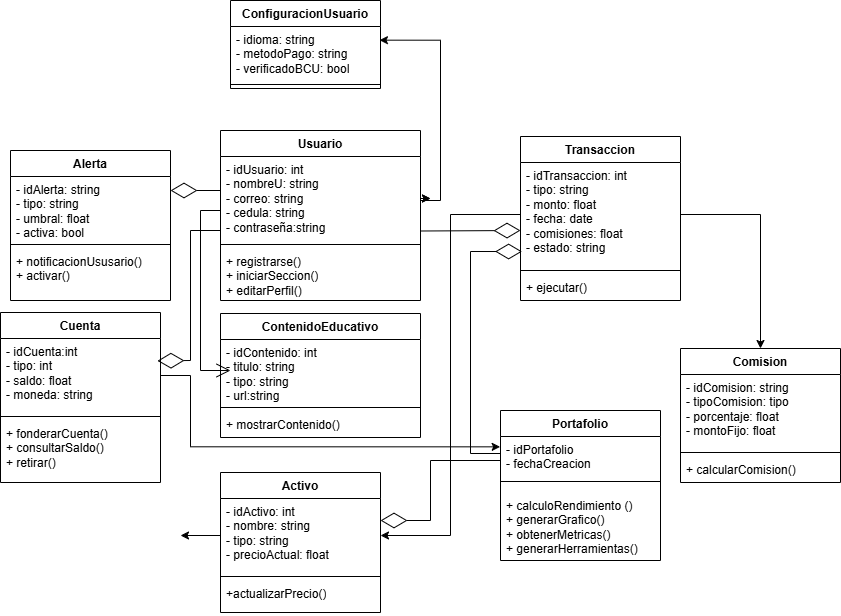 

---

## Prototipos 
Los prototipos realizados para una mejor implementacion de la aplicacion fueron:

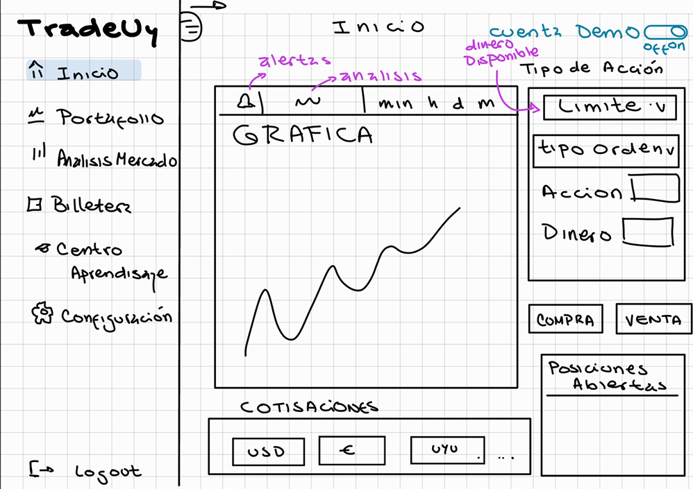 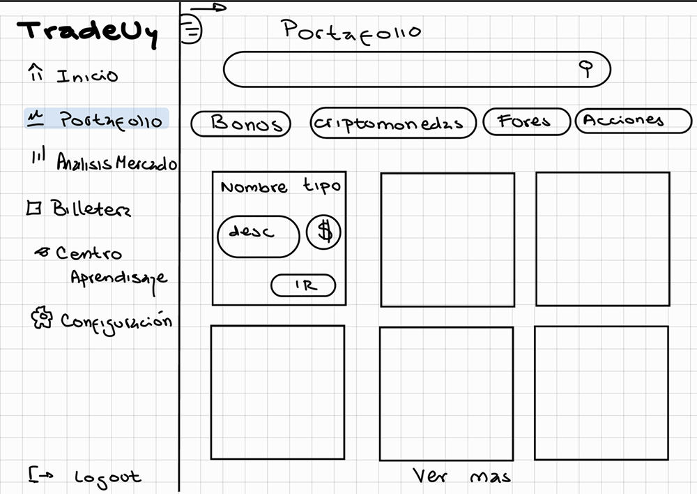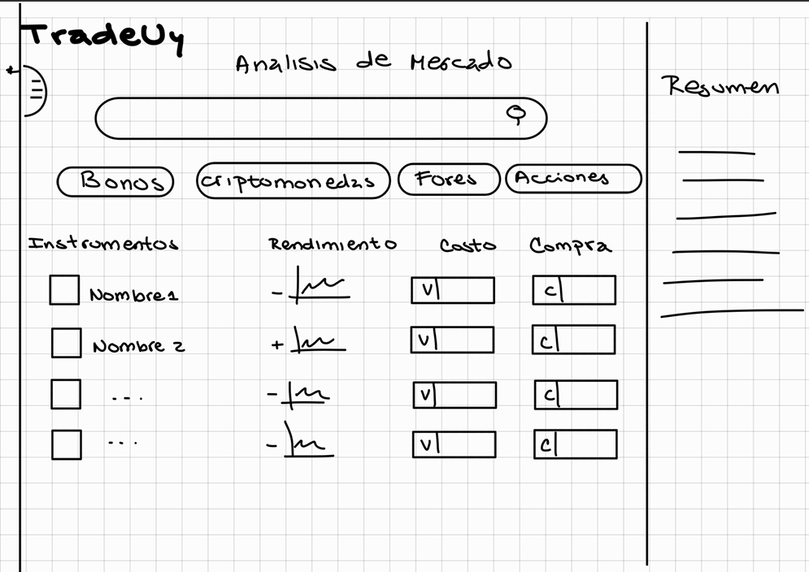 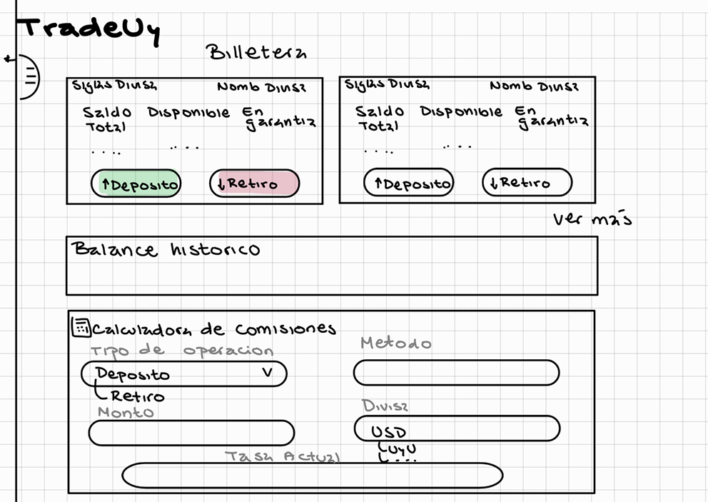 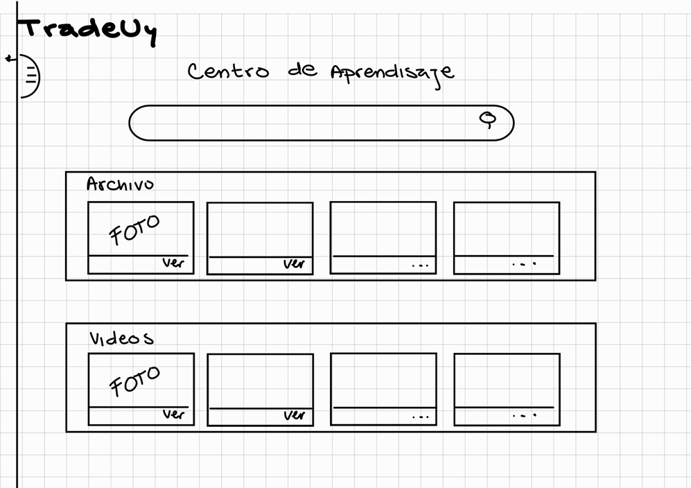 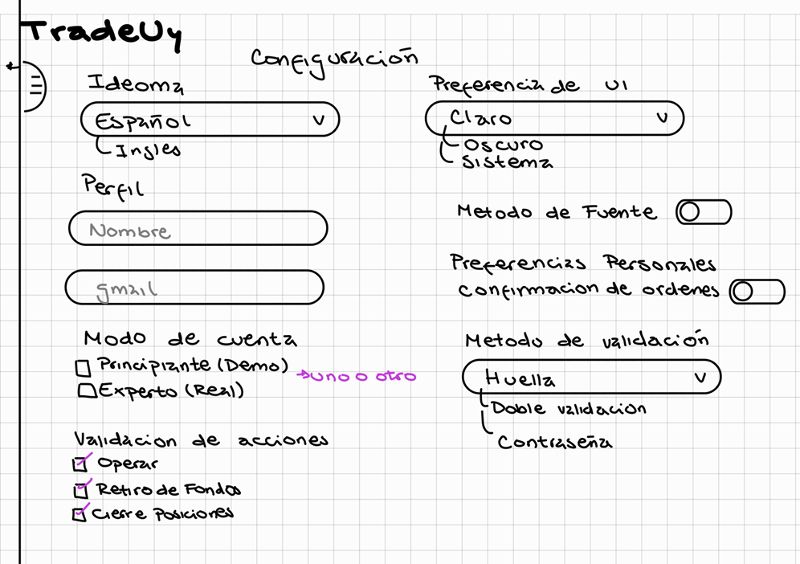
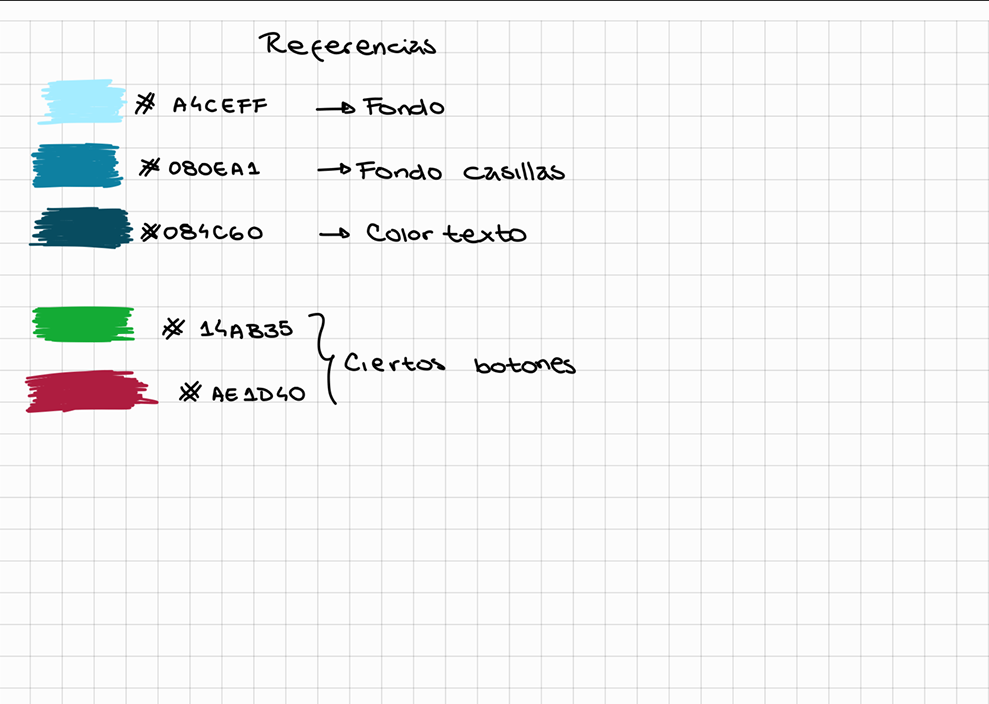

##  Verificación

Para verificar el cumplimiento de los **requisitos funcionales (RF)** y **no funcionales (RNF)**, se realizó una **revisión cruzada** entre los requisitos definidos y las pantallas del prototipo.  

Se elaboró una **checklist de trazabilidad**, donde cada requisito fue marcado como:  
- 🟩 **Implementado**  
- 🟨 **Parcialmente implementado**  
- 🟥 **Pendiente**

Esto permitió comprobar que el prototipo refleja correctamente lo establecido en el análisis y diseño.

---

### Tabla de verificación de requisitos

| ID | Requisito | Implementación en el prototipo | Estado |
|----|------------|--------------------------------|--------|
| **RF1** | Visualizar lista de instrumentos financieros | Pantalla principal con lista y precios en tiempo real | 🟩 |
| **RF2** | Ejecutar operaciones de compra y venta | Panel principal | 🟩 |
| **RF3** | Cuenta demo con saldo virtual | Opción “Cuenta demo” en página principal y configuración | 🟩 |
| **RF4** | Historial de operaciones | En la pantalla de Billetera | 🟩 |
| **RF5** | Consultar métricas de rentabilidad y riesgo | Página principal | 🟨 |
| **RF6** | Sección educativa | Centro de Aprendizaje | 🟨 |
| **RF7** | Notificaciones | Pantalla emergente | 🟥 |
| **RF8** | Cumplimiento legal y seguridad BCU | Página principal | 🟩 |
| **RF9** | Edición de perfil | Configuración | 🟩 |
| **RNF13** | Interfaz intuitiva y adaptable | Botones claros, colores semánticos | 🟨 |
| **RNF17** | Código modular y versionado | Organización por carpetas y uso de Git | 🟩 |
| **RNF20** | Uso de colores de estado | Botones verdes (compra) y rojos (venta) en el sistema | 🟩 |

---

**Conclusión:**  
La verificación demuestra que el prototipo cumple con la mayoría de los requisitos definidos.  
Los ítems marcados como 🟨 o 🟥 representan áreas de mejora a abordar en la siguiente iteración de desarrollo.

## Validación

## Descripción del Trabajo Individual de cada Integrannte

### Romina Carsin
| Fecha | Actividad | Horas invertidas |
|:------:|:----------:|:----------------:|
| 06/10 | Estructura del repositorio | 2h |
| 10/10, 9/10, 06/10 | Investigación de Información | 6h |
| 04/10, 03/10 | Entrevistas | 9h |
| 06/10, 05/10 | Ingeniería Reversa | 8h |
| 07/10 | Requerimientos | 5h |
| 13/10, 09/10 | User Persona | 3h |
| 14/10 | User Stories & Use Cases | 1h |
| 14/10, 15/10 | Modelo del Dominio | 3h |
| 14/10, 13/10, 15/10 | Verificación y Validación | 7h |

### Guzmán Costa

| Fecha | Actividad | Horas invertidas |
|:------:|:----------:|:----------------:|
| 06/10 | Estructura del repositorio | 7h |
| 10/10, 9/10, 06/10 | Investigación de Información | 3h |
| 04/10, 03/10 | Entrevistas | 5h |
| 06/10, 05/10 | Ingeniería Reversa | 6h |
| 07/10 | Requerimientos | 2h |
| 13/10, 09/10 | User Persona | 5h |
| 14/10, 15/10 | User Stories & Use Cases | 4h |
| 14/10, 15/10 | Modelo del Dominio | 8h |
| 14/10, 13/10 | Verificación y Validación | 2h |

---

### Resumen General

| Nombre | Horas trabajadas | Entrevistas Realizadas | Aplicaciones Analizadas |
|:-------:|:----------------:|:----------------------:|:-----------------------:|
| Romina Carsin | 44h | 2 | 2 |
| Guzmán Costa | 42h | 1 | 1 |

---

## Reflexión

El desarrollo del proyecto implicó una importante inversión de tiempo, comunicación constante y aprendizaje colaborativo.  
A lo largo del proceso, mantuvimos una dinámica de trabajo **basada en la coordinación, la autonomía y el intercambio permanente de avances**.  

Realizamos múltiples **llamadas y reuniones virtuales**, además de algunos encuentros presenciales, donde planificamos tareas, revisamos entregas y discutimos decisiones de diseño e investigación.  
Si bien cada integrante trabajó de forma **individual en distintos módulos del proyecto** —entrevistas, análisis de aplicaciones, documentación o prototipos—, mantuvimos una **comunicación continua por mensajes**, comentando cada avance y revisando mutuamente los aportes antes de incorporarlos al repositorio.

Ninguno de los dos integrantes tenía conocimientos previos en el área de **inversiones financieras o plataformas de trading**, por lo que fue necesario **estudiar en profundidad el tema**, investigar fuentes confiables y analizar múltiples plataformas internacionales.  
Esto nos permitió **comprender los fundamentos legales, técnicos y de usabilidad** que deben tener este tipo de aplicaciones en el contexto uruguayo.

Entre las principales **dificultades**, destacamos la necesidad de adaptar información compleja (como la regulación financiera o los modelos de trading) a un formato académico y comprensible, además de gestionar el tiempo entre la investigación y la documentación técnica.  
Sin embargo, logramos superarlas gracias a una **división clara de tareas**, revisiones conjuntas y la adopción de buenas prácticas de control de versiones en GitHub.

Consideramos que la **dinámica de trabajo fue positiva**, ya que combinó independencia y colaboración efectiva.  
El uso de ramas específicas, commits convencionales y documentación compartida nos permitió mantener un flujo ordenado y trazable.  
La experiencia también nos ayudó a desarrollar **habilidades de investigación aplicada, redacción técnica y trabajo en equipo** dentro de un contexto académico que simula un entorno profesional.

En conclusión, el proyecto representa una oportunidad valiosa para **aprender desde cero sobre el mercado financiero digital**, aplicar metodologías ágiles, mejorar la organización del trabajo y fortalecer la comunicación entre los integrantes.  

