# Informe Académico 2

## Selección de Funcionalidades

En esta etapa del proyecto de la aplicación de inversiones **TradeUy**, el equipo (Romina Carsin y Guzmán Costa) decidió implementar primero las funcionalidades esenciales que permiten al usuario **invertir desde el primer momento**, siguiendo la lógica de un MVP (Producto Mínimo Viable).

Las funcionalidades seleccionadas para su implementacion se basan directamente en los requerimientos de la Entrega 1 (RF, RNF) y en las Historias de Usuario definidas, correspondiendo a:

- **RF1** - Visualización de instrumentos financieros
- **RF2** - Compra y venta de activos
- **RF3** - Cuenta demo
- **RF4** - Historial de operaciones
- **RF6** - Sección educativa
- **RF8** - Cumplimiento básico de seguridad
- **RF11** - Mostrar comisiones
- **RNF18** - Mostrar comisiones antes de ejecutar
- **RNF20** - Uso de colores semánticos (verde/rojo)
- **US1** - Ver portafolio con variaciones
- **US2** - Comprar y vender activos
- **US4** - Tener sección educativa básica para poder aprender antes de invertir.

Además, definimos una **nueva User Story (US7):**

> _Como usuario, quiero depositar y retirar dinero en distintas monedas para gestionar mis fondos._

### Funcionalidades priorizadas (MoSCoW)
| Categoría                  | Funcionalidades                                                                                                                                                                 |
| -------------------------- | ------------------------------------------------------------------------------------------------------------------------------------------------------------------------------- |
| **Must Have**              | Visualización de instrumentos, compra/venta, portafolio, billetera (depósitos y retiros), comisiones visibles, historial de operaciones, modo demo                              |
| **Should Have**            | Análisis de mercado, filtros por categoría, buscador, variación diaria, gráfico simple, sección educativa                                                                       |
| **Could Have**             | Resumen instantáneo por activo, accesos directos a operar desde Análisis, mejoras visuales adicionales                                                                          |
| **Won’t Have (por ahora)** | Configuración avanzada, órdenes límite, métricas de riesgo avanzadas, alertas personalizadas, reportes exportables, multi-idioma, perfil de usuario, notificaciones del sistema |

### Funcionalidades fuera de alcance
Se decidió posponer algunas funciones que requieren infraestructura adicional, seguridad reforzada o una etapa más avanzada de persistencia y datos reales:

- **Tutorial inicial y onboarding guiado (RF7)**  
  Aporta valor para usuarios nuevos, pero no es crítico para el flujo principal de inversión.

- **Autenticación avanzada** como
  - _Doble autenticación (RNF2)_
  - _Gestión detallada de usuarios_
  - _Disponibilidad avanzada del sistema (RNF6)_  
    Necesitan una arquitectura con backend, sesiones, almacenamiento seguro y servicios externos.

- **Funciones de inversión avanzadas**, tales como:
  - **Órdenes límite y stop-loss**
  - **Métricas de riesgo avanzadas** (Sharpe, Drawdown real, volatilidad histórica)
  - **Alertas personalizadas de precio y variación**
  - **Reportes exportables (PDF/Excel)**  
    Estas funciones requieren persistencia histórica, cálculos continuos y mucha lógica detras.

- **Características de personalización y alcance global**, incluyendo:
  - **Multi-idioma**
  - **Configuración avanzada del usuario**
  - **Preferencias de notificación o estilo**  
    Estas funcionalidades dependen de un sistema de configuración persistente por usuario.

Estas funcionalidades serán incorporadas en futuras actualizaciones conforme avance se desarrolle la aplicacion y a base de necesidades que el usuario nos comunique.

## Usabilidad y Accesibilidad

### Diseño de la interfaz de usuario (UI)
- **Jerarquía visual clara:** títulos destacados, datos económicos resaltados, y elementos secundarios con tipografía más tenue.
- **Paleta de colores consistente:**
  - Azul/celeste para la identidad visual
  - Verde para variaciones positivas
  - Rojo para variaciones negativas
  - Verde, amarillo y rojo para notificacciones o advertencias
- **Iconografía:** uso de _Bootstrap Icons_ para reforzar acciones como operar, filtrar, buscar o navegar.
- **Layout responsivo:** toda la aplicación está construida con _Bootstrap 5_, asegurando correcta adaptación a diferentes tamaños de pantalla.
- **Navegación fluida:**
  - Menú lateral expandible en escritorio
  - Menú inferior simplificado en móviles
  - Secciones principales: _Inicio_, _Portafolio_, _Análisis_, _Billetera_ y _Centro de Aprendizaje_

### Experiencia de usuario (UX)
La experiencia de usuario en **TradeUy** fue diseñada para que cualquier persona pueda **moverse por la plataforma, entender la información y operar** sin sentirse abrumada.  
El objetivo principal fue crear un flujo claro, limpio y directo, manteniendo siempre al usuario en control.

#### Flujo intuitivo de interacción
- Las operaciones siguen un recorrido natural:  
  **seleccionar activo -> ingresar monto o cantidad -> verificar -> confirmar -> ver historial**.
- En Inicio, el precio, la variación y los botones de comprar/vender están siempre visibles, evitando confusiones o pasos innecesarios. Asi mismos no se pide una verificacción antes de operar pues el usuario perderia timpo valioso que no considerado anteriormente.
- En Billetera, los botones de _Depósito_ y _Retiro_ abren un modal simple y guiado, evitando pantallas sobrecargadas.

#### Reducción de carga mental
- Los valores se muestran formateados y con unidades claras (USD o UYU).
- El sistema calcula automáticamente _cantidad o dinero_, lo que evita errores al operar y reduce el esfuerzo del usuario.
- En Portafolio y Análisis, las categorías permiten segmentar la información en bloques manejables (Acciones, Bonos, Cripto, Forex).

#### Retroalimentación inmediata en cada acción
- Las alertas informan de forma clara si una operación fue exitosa o si hubo un error.
- Los gráficos del activo se actualizan en tiempo real, mostrando cambios en cuestión de segundos.
- Al cambiar entre **USD/UYU**, todo el contenido relevante se recalcula instantáneamente, reforzando la sensación de control.

#### Prevención activa de errores
- No se permite ingresar montos inválidos (vacíos, negativos, erróneos).
- En movimientos de dinero, el modal muestra un **desglose previo de comisiones**, ayudando al usuario a validar antes de confirmar.
- Si falta información o la cantidad no cumple las reglas del sistema, la acción se bloquea y se explica el motivo.

#### Consistencia visual y de interacción
- Todas las secciones mantienen la misma lógica estructural:  
  **título -> filtros u opciones -> contenido principal**.
- Los botones siguen un patrón uniforme:
  - **Azul** para acciones neutrales
  - **Verde** para confirmar
  - **Amarillo/Rojo** para retiros y alertas
- La navegación se siente igual en todas las pantallas, evitando que el usuario deba “aprender de cero” cada vez que cambia de sección.

#### Aprendizaje integrado dentro de la plataforma
- El **Centro de Aprendizaje** permite explorar videos y contenido educativo sin salir de la aplicación.
- Esto acompaña a los usuarios nuevos, que pueden aprender conceptos básicos antes de realizar operaciones reales o demo.

### Capturas del prototipo UI
> Pantalla de inicio  
> 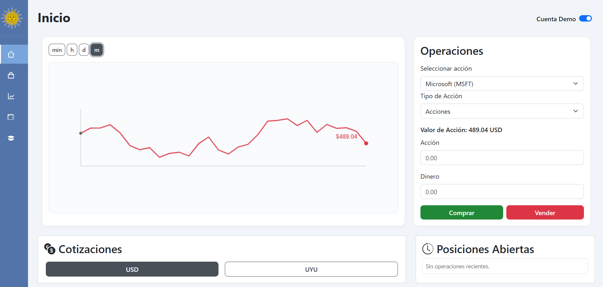
> 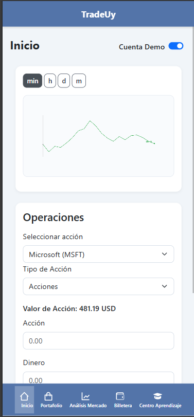

> Pantalla Portafolio  
> 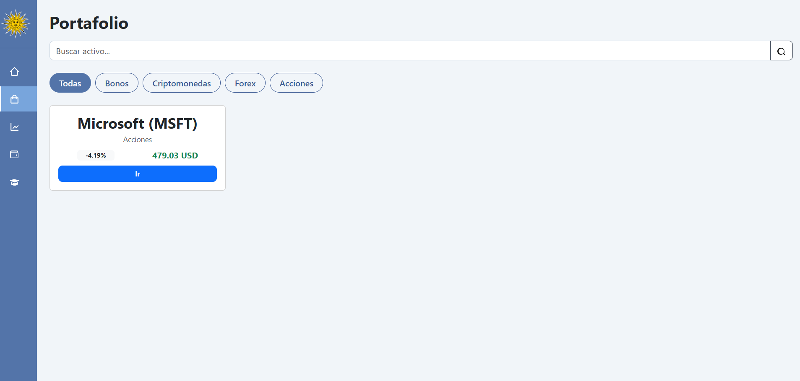
> 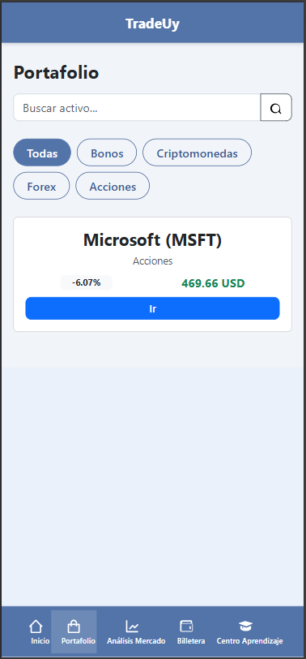

> Pantalla Análisis  
> 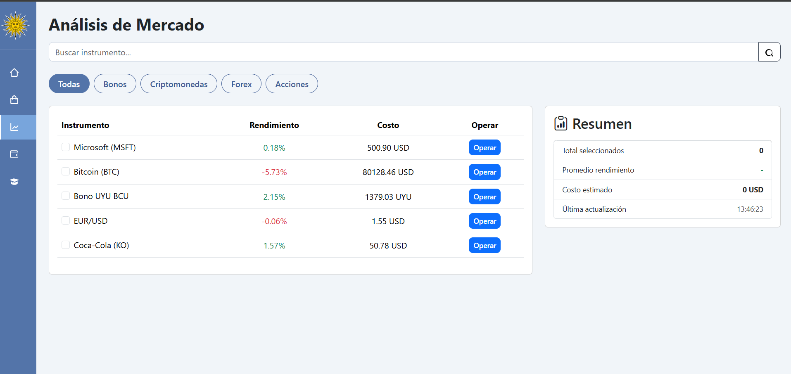
> 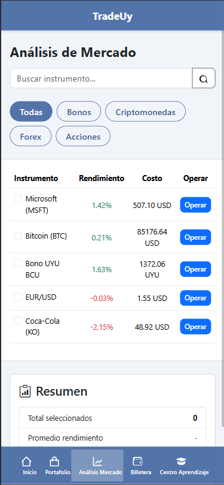

> Pantalla Billetera  
> 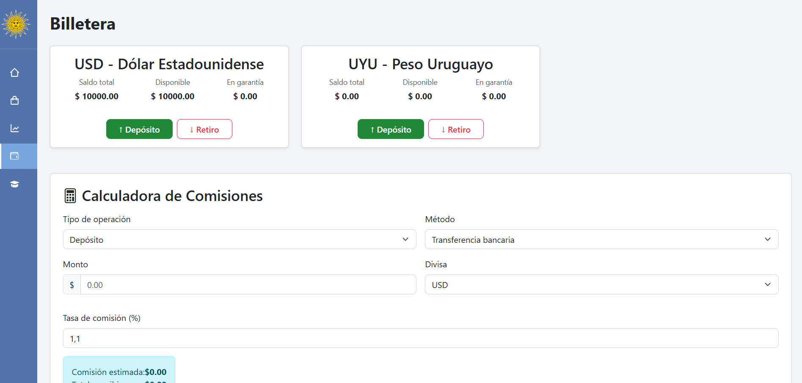
> 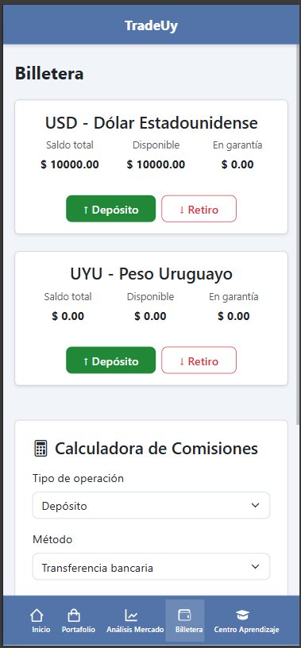

> Pantalla Centro Aprendizaje
> 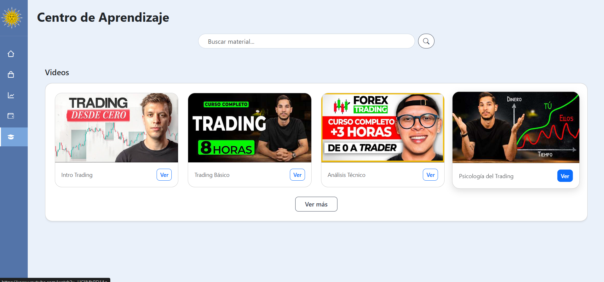
> 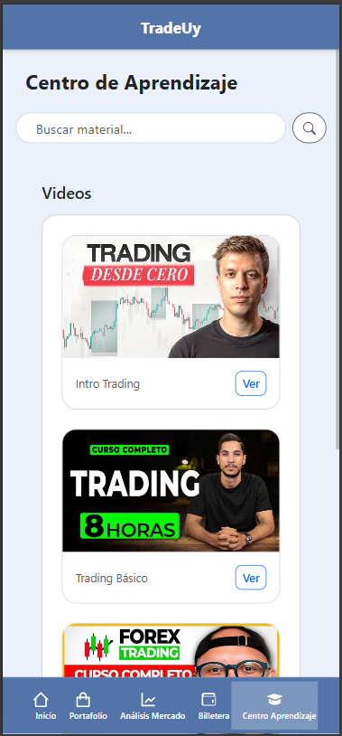

### Principios de Usabilidad Aplicados (Nielsen)
En el diseño de la aplicaccion se aplicaron las 10 heurísticas de usabilidad de Nielsen, adaptadas a **TradeUy**. Estas guías permitieron construir una interfaz más clara, segura y coherente para el usuario.

#### 1. Visibilidad del estado del sistema
La aplicación informa constantemente lo que está pasando:

- Alertas que confirman compras, ventas o errores.
- Actualización automática de precios en Inicio y Análisis.
- Cambios visuales inmediatos al seleccionar USD/UYU.

#### 2. Correspondencia con el mundo real
Se utilizan términos propios del ámbito financiero (“Valor de Acciones”, “Variación”, “Saldo disponible”) y formatos locales (pesos uruguayos) de moneda.

#### 3. Control y libertad del usuario
El usuario puede cancelar cualquier operación antes de confirmarla. A esepción de compra y venta que los usuarios indicaron que no querian perder tiempo al realizar la acción.
En los modales de depósito/retiro, cerrar la ventana no afecta el saldo.  
En Inicio, cambiar la cantidad o el monto no ejecuta ninguna acción automática.

#### 4. Consistencia y estándares
Los botones mantienen estilos uniformes (verde/rojo/azul/amarillo).  
Los filtros funcionan igual en Portafolio y Análisis.  
Las tarjetas de activos comparten la misma estructura visual.

#### 5. Prevención de errores
- No permite cantidades vacías, negativas o inválidas.
- En movimientos, se muestra un desglose previo (monto, comisión, total).
- Se bloquean operaciones si no se cumplen reglas del dominio.

#### 6. Reconocer antes que recordar
El sistema evita que el usuario tenga que memorizar pasos:

- Los botones de operar están a la vista.
- Las categorías muestran íconos y texto.
- Las unidades (USD/UYU) aparecen junto al valor.

#### 7. Flexibilidad y eficiencia de uso
Los usuarios pueden operar directamente desde el análisis de mercado.  
Buscar por nombre en Portafolio o Análisis acelera la búsqueda de activos.  
El filtrado por categoría facilita ubicar instrumentos específicos.

#### 8. Diseño estético y minimalista
Las pantallas muestran solo la información esencial y se trata de que toda la informacion posible esta a la vista (se puede observar en modo escritorio):

- Precio, variación y dinámicas del activo.
- Formularios simples para operar.
- Gráficos limpios y sin elementos distractores.

#### 9. Ayuda para reconocer y recuperarse de errores
Cuando una operación no se puede ejecutar, se explica claramente la causa:  
“Saldo insuficiente”, “Cantidad inválida”, “Ingrese un monto válido”, etc.

#### 10. Ayuda y documentación
El Centro de Aprendizaje ofrece contenido para usuarios nuevos, y los mensajes dentro de los formularios indican cómo completar cada acción correctamente.
Ademas para usuarios nuevos o inespertos existe el modo demo donde los usuarios puedes utilizar y conocer la aplicacción sin riesgo de gastar dinero real.

### Criterios WCAG aplicados
Durante el desarrollo de **TradeUy**, se tuvieron en cuenta los lineamientos de accesibilidad del estándar **WCAG 2.1**, enfocados en mejorar la experiencia de usuarios en dispositivos móviles y de escritorio.  
En las pruebas realizadas con la herramienta **WAVE**, la aplicación **no presentó errores de accesibilidad**, únicamente algunas _alertas_ derivadas de razones externas al código del proyecto.

#### Perceptible
- **Contrastes adecuados:** se utilizaron colores con suficiente contraste entre texto y fondo (azul/celeste para estructura, verde/rojo para variaciones).
- **Elementos distinguibles:** botones, tarjetas y valores económicos mantienen jerarquía clara.
- **Texto alternativo evitado donde corresponde:** los íconos decorativos de Bootstrap Icons no requieren alt-text, respetando las pautas WCAG.

#### Operable
- **Navegación con teclado:** todos los elementos interactivos son accesibles mediante la tecla _Tab_.
- **Estructura simple:** las secciones están organizadas de forma predecible: título, filtros/opciones y contenido.
- **Botones suficientemente grandes:** diseñados para facilitar el uso táctil en móviles.

#### Comprensible
- **Lenguaje claro y coherente:** los términos financieros se explican de forma directa mediante etiquetas y mensajes.
- **Mensajes de error consistentes:** indican la causa del problema (monto inválido, saldo insuficiente, etc.).
- **Formularios con validación temprana:** ayudan a evitar errores antes de ejecutar operaciones.

#### Robusto
- **Compatible con navegadores modernos** (Chrome, Edge, Firefox, Opera).
- **Estructura HTML semántica:** uso de encabezados, secciones y botones reales.

---

### Observaciones de WAVE
Durante la evaluación completa con la herramienta WAVE:

- **No se detectaron errores de accesibilidad** relacionados con el contenido, estructura o semántica del sistema.
- Las únicas alertas provienen de:
  - **Videos embebidos de YouTube** en el _Centro de Aprendizaje_, que generan advertencias externas.
  - **Texto pequeño en el menú inferior de móviles**, debido a limitaciones de espacio en pantallas reducidas, lo cual genera alertas pero **no errores**.

Estas observaciones no afectan la funcionalidad ni rompen ninguna regla WCAG; simplemente indican áreas de mejora opcionales para futuras versiones.
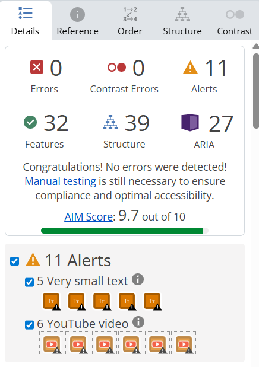

## Calidad de Código
La calidad del código fue una prioridad durante el desarrollo de **TradeUy**, buscando mantener una base clara, escalable y fácil de testear.  
Si bien la estructura final difiere parcialmente del UML planteado en el Informe 1, esta reorganización se realizó para lograr un sistema más modular y alineado con las necesidades reales de la implementación.

### Estructura del Proyecto
La organización del código quedó distribuida de la siguiente forma:

```plaintext
src/
├── domain/
│   ├── Activo.js
│   ├── AnalisisMercado.js
│   ├── Billetera.js
│   ├── CalculadoraComisiones.js
│   ├── Controller.js
│   ├── ControlOperaciones.js
│   ├── Cotizaciones.js
│   ├── cuenta.js
│   ├── CuentaDemo.js
│   ├── CuentaReal.js
│   ├── HistorialOperaciones.js
│   ├── ListaActivos.js
│   ├── Modo.js
│   ├── Operaciones.js
│   └── portafolio.js
│
├── domain/test/
│   ├── Activo.test.js
│   ├── AnalisisMercado.test.js
│   ├── Billetera.test.js
│   ├── CalculadoraComisiones.test.js
│   ├── Controller.test.js
│   ├── ControlOperaciones.test.js
│   ├── Cotizaciones.test.js
│   ├── Cuenta.test.js
│   ├── CuentaDemo.test.js
│   ├── CuentaReal.test.js
│   ├── HistorialOperaciones.test.js
│   ├── ListaActivos.test.js
│   ├── Modo.test.js
│   ├── Operaciones.test.js
│   └── Portafolio.test.js
│
├── interface/
   ├── main.js
   ├── index.html
   ├── style.css
   ├──  interface/ img

```

### Arquitectura del Código
El proyecto adoptó una **arquitectura modular por capas**, distinta al UML del Informe 1, pero más adecuada para la implementación real. Esta organización mejora la mantenibilidad, separa responsabilidades y facilita el testing.

| Capa         | Ubicación              | Rol principal                                          |
| ------------ | ---------------------- | ------------------------------------------------------ |
| **Dominio**  | `src/domain/*.js`      | Lógica de negocio: cálculos, validaciones y estado.    |
| **Testing**  | `src/domain/test/*.js` | Pruebas unitarias independientes del DOM.              |
| **Interfaz** | `src/interface/*.js`   | Manejo del DOM, inputs y Conecta la UI con el dominio. |

Esta estructura permitió:

- Separar totalmente la lógica del DOM,
- Testear el dominio sin interfaz,
- Escalar funcionalidades sin romper módulos existentes.

### Estándares de Calidad y Herramientas Utilizadas
Para garantizar consistencia entre módulos y evitar errores comunes, se emplearon las siguientes herramientas:

#### ESLint
ESLint se utilizó para análisis estático del código, permitiendo detectar errores antes de la ejecución.

Detectó:

- Variables no utilizadas
- Imports incorrectos
- Desmaciados enters
- Funciones demasiado extensas
- Malas prácticas comunes en ES Modules

La configuración utilizada se basó en **`eslint:recommended`**, con reglas adicionales de estilo y consistencia.

**Resultado:** código más consistente, seguro y fácil de revisar.

#### Prettier
Prettier se empleó para el formateo automático del código, garantizando:

- Indentación uniforme
- Uso coherente de comillas
- Eliminación de espacios innecesarios
- Estilo consistente en **HTML, CSS y JS**

**Resultado:** todos los archivos comparten un estilo visual uniforme y legible.

#### Live Server
Herramienta utilizada para testing continuo y validación visual durante el desarrollo.

- **Live Server:** permitió visualizar cambios en tiempo real durante la edición.

#### Convenciones aplicadas
- Uso de **camelCase** en variables y funciones
- Nombres descriptivos y semánticos
- Funciones pequeñas y de responsabilidad única
- Evitar variables globales
- Validaciones tempranas para prevenir estados inválidos
- Uso consistente de **ES Modules** en todo el proyecto

## Pruebas Unitarias
Las pruebas unitarias jugaron un rol central en la verificación de la lógica del dominio de **TradeUy**.  
El objetivo principal fue asegurar que todas las reglas de negocio funcionaran correctamente antes de integrar las funcionalidades con la interfaz.

### Alcance de las pruebas
Se realizaron pruebas unitarias **para cada una de las clases del dominio**.
Esto incluye:  
`Activo`, `AnalisisMercado`, `Billetera`, `CalculadoraComisiones`, `Controller`,  
`ControlOperaciones`, `Cotizaciones`, `Cuenta`, `CuentaDemo`, `CuentaReal`,  
`HistorialOperaciones`, `ListaActivos`, `Modo`, `Operaciones`, `Portafolio`.
Cada clase fue probada con:

- Entradas válidas
- Entradas inválidas
- Casos de borde
- Pruebas de errores esperados (`throw`)

### Librería utilizada
Se empleó **Jest** como framework de testing, permitiendo ejecutar las pruebas de manera aislada, reproducible y automatizada.  
Todas las pruebas se encuentran en el directorio:

### Casos de borde incluidos
Las pruebas contemplaron casos extremos para asegurar la robustez del sistema:
- Cantidades negativas, nulas o extremadamente grandes  
- Montos fuera de rango o valores no numéricos  
- Activos inexistentes o intentos de operar con valores inválidos  
- Validaciones de fechas pasadas, futuras o vacías  
- Reglas de negocio como:
  - disponibilidad de activos  
  - saldo suficiente  
  - cálculo correcto de comisiones  
  - actualizaciones del portafolio  

### Cobertura obtenida

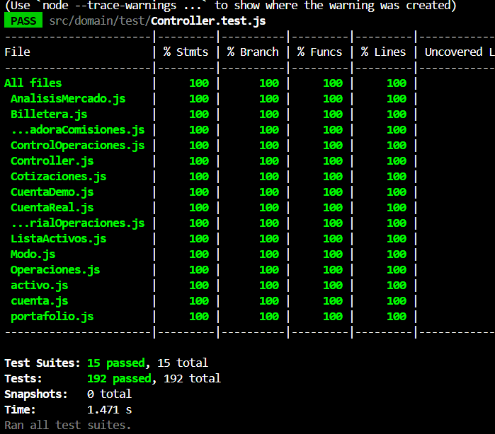

Esto garantiza que la lógica interna del sistema fue completamente verificada antes de conectarse con la interfaz.


## Descripción del Trabajo Individual
A nivel general, la distribución del trabajo entre los integrantes fue equilibrada, con enfoques complementarios:

- **Romina Carsin** se encargó principalmente de la **interfaz**, **accesibilidad**, **integración visual**, **conexión de funcionalidades en pantalla** y parte crítica del **testing unitario** (especialmente `Controller`).  
  Además, fue responsable del **Informe Académico 2** y del **Informe de Testing**.

- **Guzmán Costa** se centró en la **lógica del dominio**, la **estructura base del sistema**, la **integración funcional entre capas** y la **totalidad del testing unitario del dominio** (excepto `Controller`).  
  También colaboró en **UI inicial**, refactorizaciones y ajustes funcionales.


---

### **Romina Carsin**

#### Descripción breve
Romina se enfocó en la interfaz del sistema, accesibilidad, integración de funcionalidades visuales, correcciones estéticas, testing unitario de Controller y elaboración de informes.

#### Tabla de actividades realizadas

| Fecha | Actividad | Horas |
|:-----:|-----------|:-----:|
| 01/11/2025 - 17/11/25 | Implementación de UI, navegación y estructura visual  Integración de compra, venta y billetera en la interfaz | 73h |
| 01/11/2025 - 17/11/25 | Correcciones de accesibilidad (WCAG/WAVE) | 5h |
| 14/11/2025 - 19/11/2025 | Testing unitario de Controller | 8h |
| 28/11/2025 - 30/11/2025 | Pruebas de caja negra y elaboración de issues | 26h |
| 28/11/2025 -30/11/2025 | Pruebas de caja negra y elaboración de issues | 26h |
| 30/11/2025 -1/11/2025 | Elaboración del Informe de Testing| 15h |
| 1/12/2025 | Elaboración del Informe 2| 7h |


### **Guzmán Costa**

#### Descripción breve
Guzmán centró su aporte en la lógica del dominio, estructura base, pruebas unitarias del dominio, integración funcional entre capas y apoyo en UI inicial.

#### Tabla de actividades realizadas

| Fecha | Actividad | Horas |
|:-----:|-----------|:-----:|
| 31/10/2025 - 17/11/2025 | Implementación del dominio y clases base, refactorización y ajustes de modelos | 42h |
| 16/11/2025 - 18/11/2025 | Testing unitario completo del dominio (excepto Controller) | 17h |
| 23/11/2025 | Aportes en documentación del sistema (Informe 2)| 4h |


## **Resumen General**
| Nombre | Horas trabajadas 
| :-----------: | :--------------: 
| Romina Carsin | 119h |
| Guzmán Costa | 63h |

## Reflexión

El trabajo en esta segunda entrega permitió profundizar en aspectos técnicos y organizativos del proyecto, revelando tanto fortalezas como desafíos importantes dentro del equipo.

### Organización y comunicación
La organización del equipo no fue equilibrada.  
En la práctica, **la mayor parte de la coordinación, seguimiento y avance del proyecto recayó en Romina**, quien debió recordar en múltiples ocasiones las tareas pendientes, insistir para obtener avances y, en algunos casos, realizar implementaciones completas ante la falta de respuesta.  
Hubo situaciones en las que, pese a intentar comunicarse por diversos medios, **no se obtuvo respuesta o colaboración oportuna**.

Aun así, cuando la comunicación se logró establecer, **la integración final de las partes técnicas fue efectiva**, especialmente en la conexión entre dominio y UI.

### Resolución de problemas técnicos

El equipo se apoyó principalmente en:
- Los **requerimientos definidos** y las **User Stories** planteadas en la entrega anterior.
- El **prototipo de interfaz**, que sirvió como guía visual y funcional.
- Las **diapositivas del curso**, explicaciones del profesor y aportes de compañeros.
- **Herramientas de IA**, que fueron especialmente valiosas para identificar casos límite, detectar inconsistencias y proponer soluciones que no estaban contempladas inicialmente.

Gracias a esto, se resolvieron problemas como:
- La generación automática de la **gráfica de comportamiento**, tomando como base una idea conceptual y refinándola con ayuda de IA.
- La creación de **cards dinámicas**, que inicialmente no estaban claras a nivel técnico.
- La depuración de errores complejos en la lógica del dominio, en las capas de integración y en los test unitarios.


### Desafíos técnicos y de coordinación

Los desafíos más relevantes fueron:

- **Desbalance en la carga de trabajo**, con avances concentrados en una  integrante.
- Dificultad para coordinar tareas en paralelo por la falta de comunicación constante.
- Necesidad de reorganizar la estructura original propuesta en el UML para ajustarla a la implementación real.
- Integrar múltiples funcionalidades nuevas manteniendo coherencia visual y lógica.
- Implementar testing unitario completo sin una división clara de responsabilidades desde el inicio.

A nivel técnico, se superaron retos de integración entre capas, validaciones complejas y adaptación de la UI a distintos dispositivos.

### Aprendizajes respecto a la entrega anterior
- **La importancia del trabajo continuo**: avanzar de forma espaciada o irregular dificulta mantener coherencia técnica y organizativa.
- **El valor de una estructura modular clara**: permitió reusar código y evitar romper funcionalidades previas.
- **El rol de las pruebas unitarias**: ayudaron a detectar errores que visualmente pasaban desapercibidos.
- **La necesidad de comunicación regular** para distribuir el trabajo de manera justa.
- **Mejor comprensión del desarrollo de interfaces**, accesibilidad y manejo de eventos.
- **Uso más eficiente de carpetas y organización de archivos**, lo que facilitó testing e integración.

### Mejores prácticas para próximos proyectos

Para futuras entregas, se propone:
- **Establecer reuniones cortas y frecuentes** para coordinar tareas y evitar desbalances.
- Utilizar un **tablero de tareas (Kanban)** donde cada integrante indique qué hace y cuándo.
- Definir **responsabilidades fijas desde el inicio**, para evitar confusiones y sobrecargas.
- Revisar avances cada semana para mantener consistencia en el estilo y la lógica del código.
- Mantener una **comunicación clara y constante**, especialmente cuando uno de los integrantes no puede avanzar.
- Aplicar diseño modular desde el inicio, reduciendo la necesidad de refactorizaciones profundas.
- Documentar de forma continua para evitar perder decisiones importantes.
- Implementar testing unitario desde las primeras etapas y no al final.
