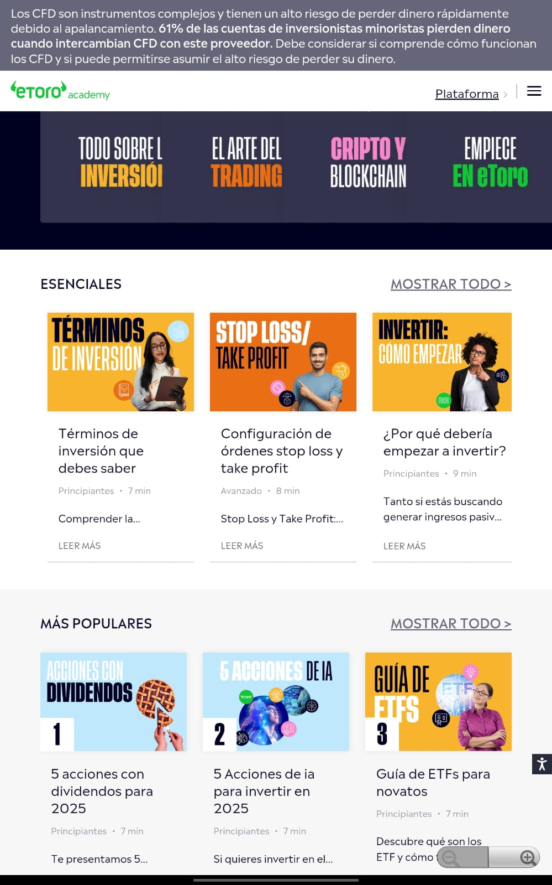
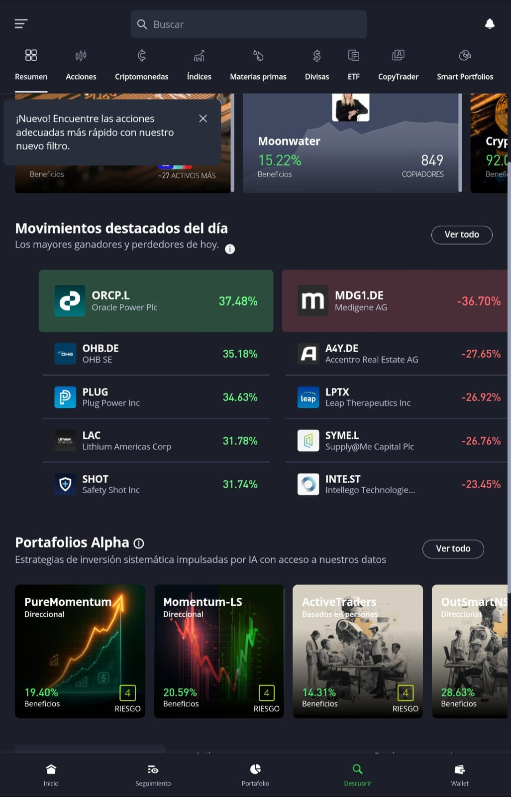
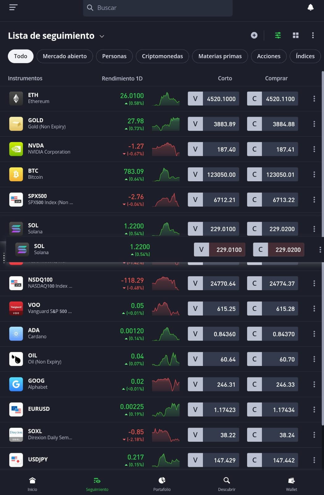
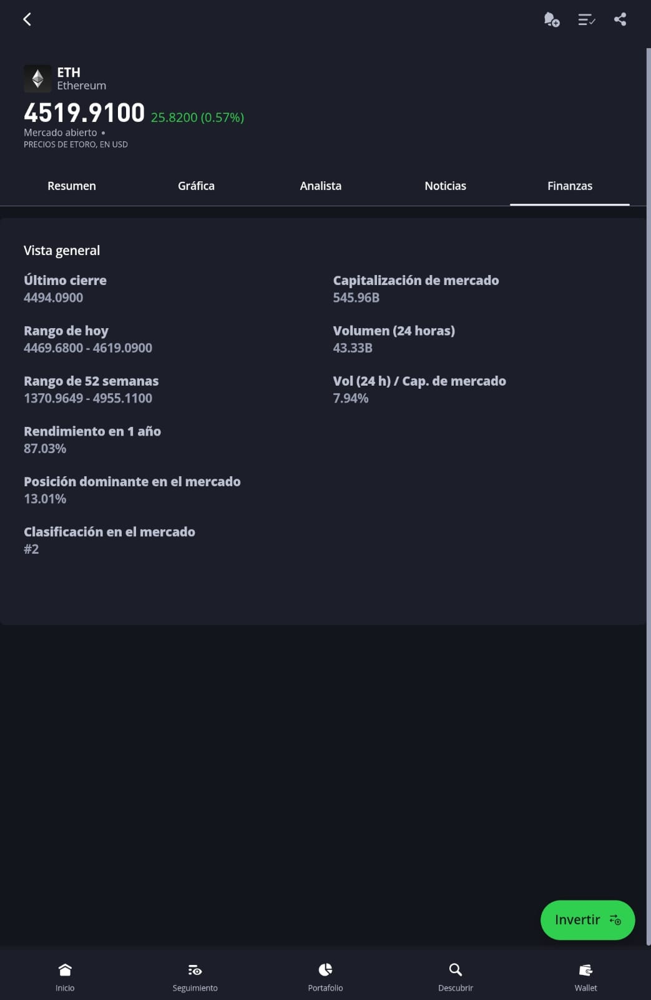
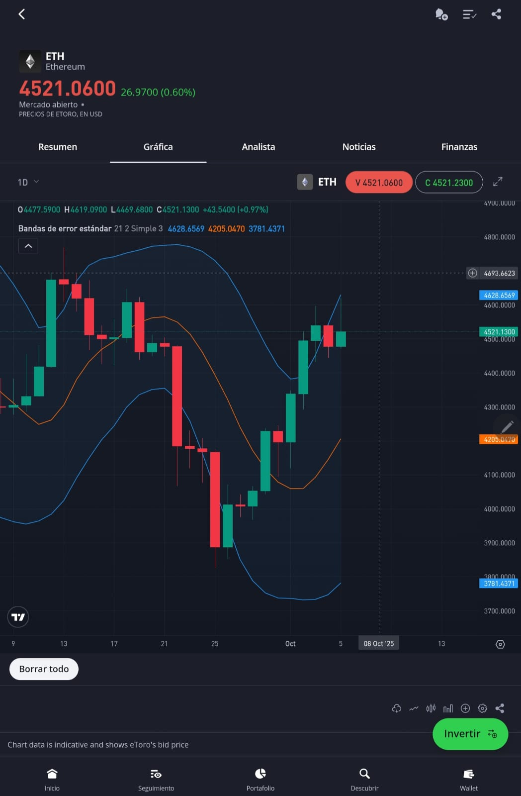

# eToro 

## Análisis de aplicacion
### Como abrir una operacion
Buscamos la acción que queremos y le damos a invertir.

Ahí nos sale la pestaña donde ponemos la plata que le queremos meter, y solo con poner el monto ya nos calcula automáticamente qué fracción de acción estamos comprando.

Para poder setear el stop loss, hay que cambiar el tipo de orden a "Orden Límite". En cuanto hacemos eso, nos aparece el cuadro de precio de la orden de compra. Ahí mismo metemos el valor al que queremos que salte el stop loss.

Si querés, podés activar la función dinámica del stop loss, que es bastante práctica porque va ajustando el nivel de stop loss para arriba a medida que la acción sube, así protege las ganancias. Es por gustos, pero para el trading viene muy bien.

### Ingenieria Revera

**Criterio** | **Lo que hace eToro** | **Fortalezas / Ventajas** | **Debilidades / Riesgos / Áreas poco claras** | **Qué verificar en pruebas directas** |
|---------------|-----------------------|-----------------------------|-----------------------------------------------|---------------------------------------|
| **Fondeo / operación** | Permite fondear la cuenta con transferencias bancarias, tarjetas internacionales, PayPal, Skrill, Neteller, entre otros. Opera en múltiples monedas, aunque la base es USD. | Gran variedad de medios de depósito, acreditación rápida, posibilidad de operar desde distintos países. | Conversión obligatoria a USD con comisiones por tipo de cambio. Algunos usuarios reportan demoras o comisiones altas en retiros. | Ver tiempos reales de acreditación y retiro, comisiones efectivas, conversiones de moneda y límites mínimos/máximos por método. |
| **Instrumentos disponibles / listas de activos** | Ofrece acciones, ETFs, criptomonedas, commodities, índices y divisas mediante CFDs. En Uruguay no permite invertir en acciones reales. | Gran diversidad de instrumentos y mercados. | En Uruguay sólo se puede operar con CFDs. Complejidad para distinguir tipos de producto. | Revisar qué activos están habilitados desde Uruguay (CFD vs reales) y qué tipo de productos predominan según el perfil de usuario. |
| **Trading social / CopyTrading** | Permite copiar a otros inversores (“Popular Investors”), crear portafolios automáticos y compartir estrategias. | Sistema de copia y portafolios temáticos que facilitan el aprendizaje observando a otros. | Riesgo elevado si el inversor copiado toma malas decisiones. Métricas de riesgo no siempre claras. | Evaluar qué métricas se muestran, si puede pausarse o editarse la copia, establecer límites de pérdida y probar diferentes estrategias. |
| **Interfaz / experiencia de usuario** | Interfaz moderna e intuitiva, con paneles de portafolio, mercado, noticias, seguimiento y wallet. | Excelente experiencia de usuario, accesible para principiantes. | Algunas funciones avanzadas (órdenes condicionales, stop loss complejo) están poco visibles. | Ver si se puede personalizar el panel, crear listas y consultar vistas del desempeño histórico. |
| **Gráfica / visualización de precios / portafolio** | Gráficos interactivos con velas, indicadores técnicos, herramientas de dibujo y comparaciones. | Buenas herramientas para análisis técnico. | Algunos indicadores o comparaciones no disponibles en versión móvil. | Evaluar si permite RSI, MACD, medias móviles y profundidad del análisis técnico en la app. |
| **Mínimos de compra / límites** | Mínimo de $10 por operación, $200 para copiar inversores y $500 para CopyPortfolios. | Mínimos razonables para la oferta que presenta. | CopyPortfolios inaccesibles para capitales pequeños. | Revisar si los mínimos varían por activo o región y si existen límites de exposición total. |
| **Costos y comisiones** | Sin comisión en acciones reales (no CFD). Spreads variables según activo, comisión fija de retiro ($5) y costo por conversión de divisas. | Modelo competitivo, especialmente en acciones reales. | Spreads amplios en criptomonedas o CFDs, comisión de retiro alta para montos bajos. | Calcular costos reales considerando spreads, comisiones y conversión de moneda local. |
| **Seguridad / regulación / custodia** | Regulada por FCA (Reino Unido), CySEC (Chipre) y ASIC (Australia). Usa fondos segregados, autenticación 2FA y protección contra saldo negativo. | Altamente regulada, buena reputación en seguridad. | Fondos en USD no cubiertos por seguros como FDIC. Custodia cripto sin claves privadas. | Revisar políticas de segregación, regulación aplicable desde Uruguay y mecanismos de autenticación y recuperación. |
| **Alertas y seguimiento** | Permite crear alertas de precio, seguimiento de portafolio y notificaciones en tiempo real. | Buenas herramientas para monitorear el mercado. | No admite alertas complejas (por volatilidad o eventos fundamentales). | Ver si se pueden configurar alertas por variación porcentual o niveles específicos. |
| **Manuales / asistencia educativa** | Ofrece eToro Academy, blog educativo, videos, guías interactivas y sección de ayuda. | Amplio material educativo para principiantes. | Algunos contenidos sin traducir o no actualizados según la región. | Ver si el contenido educativo está integrado en la app o sólo disponible en web. |
| **Advertencias de riesgo / transparencia** | Muestra advertencias claras sobre el riesgo de CFDs (alta tasa de pérdida en cuentas minoristas). | Transparente respecto al riesgo de apalancamiento y volatilidad. | Advertencias pueden pasar desapercibidas para nuevos usuarios. | Observar cómo se presentan los disclaimers al abrir operaciones o copiar traders. |
| **Atención al cliente / soporte** | Soporte vía chat, tickets online y base de conocimiento. Disponible en varios idiomas. | Canales variados y buena documentación. | Respuestas lentas y sin soporte telefónico. | Evaluar tiempo de respuesta, claridad y disponibilidad en español. |

## Anexo

