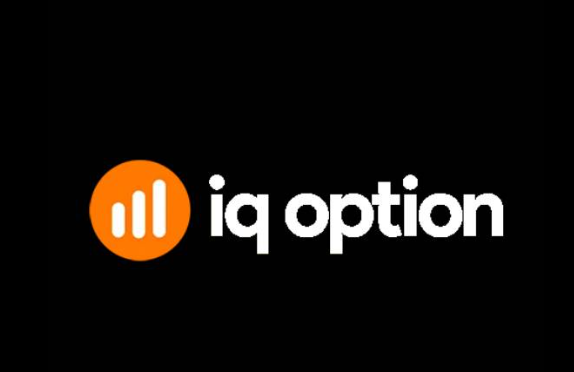
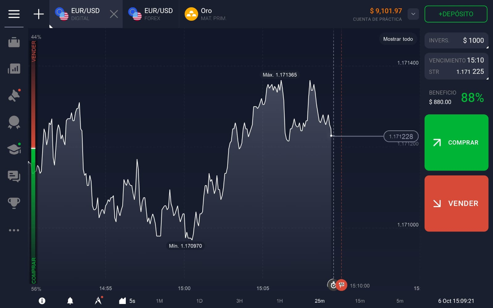
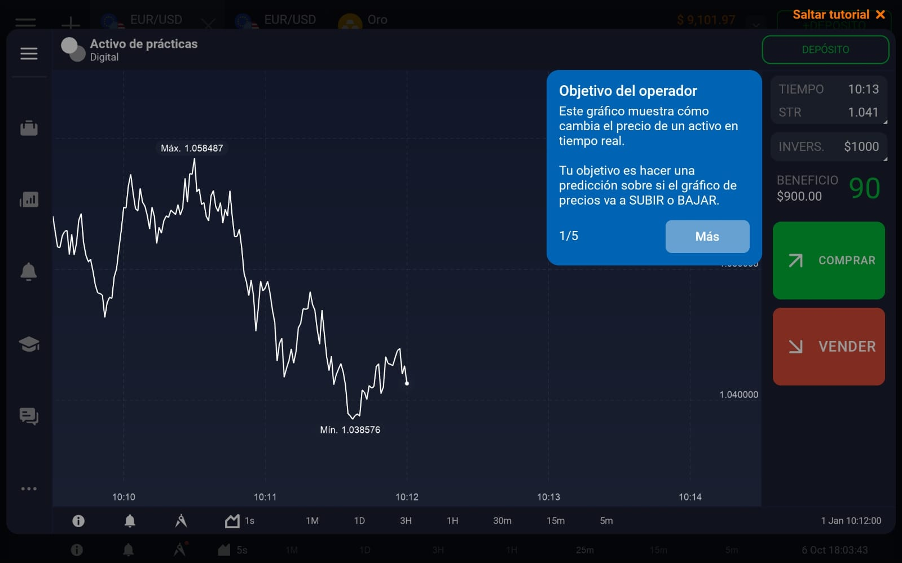
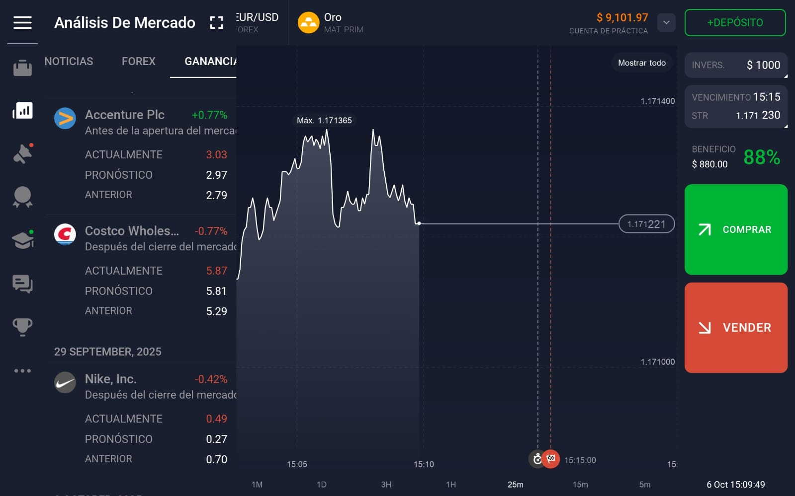
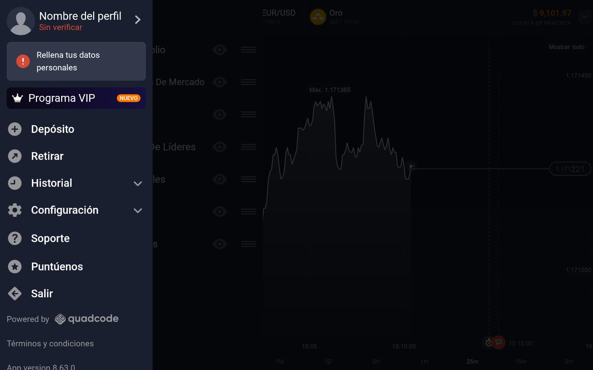
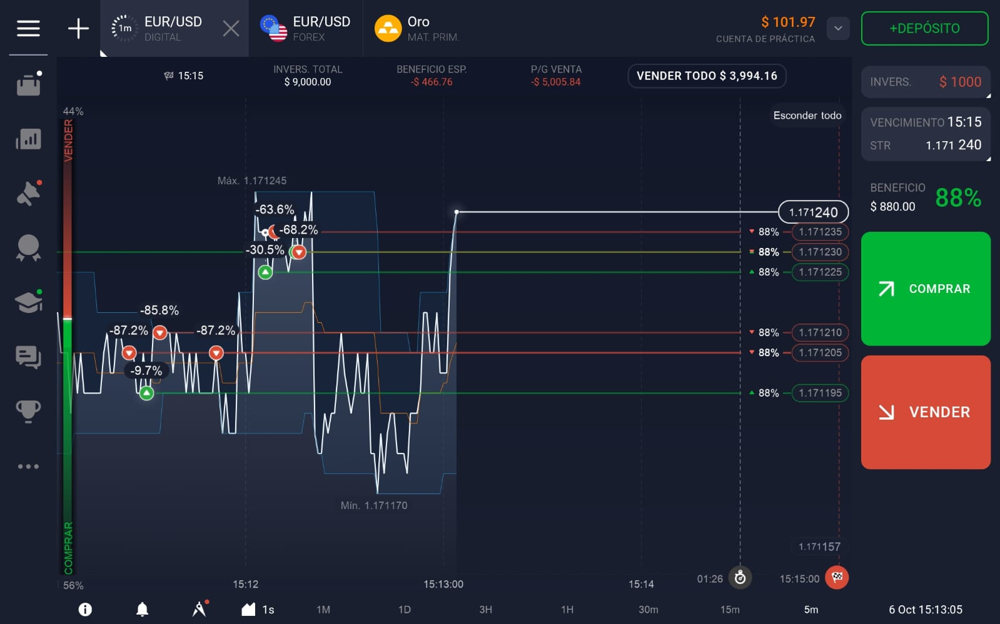
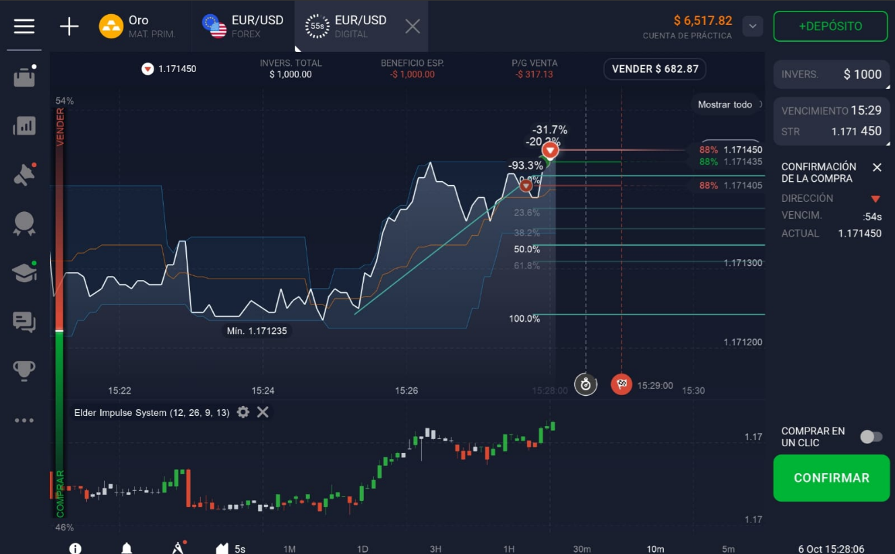
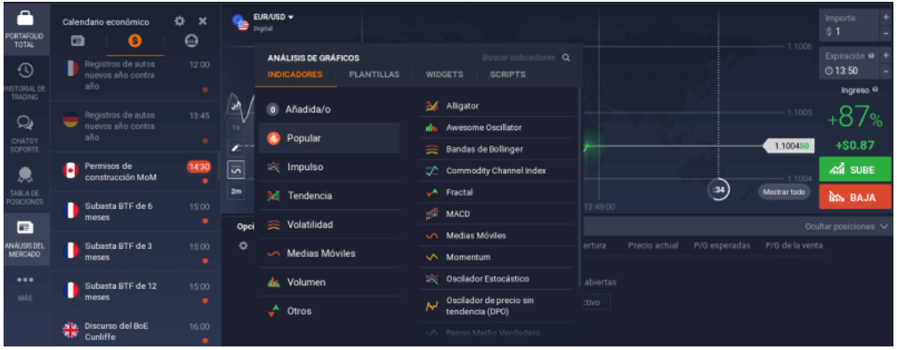

# IQ Option

## Análisis de aplicacion

Es una aplicación con una interfaz clara, todo está a la vista y no te perdes tanto al ser inexperto. Las gráficas se pueden personalizar, cambiar los tiempos, poner indicadores técnicos, dibujar líneas o patrones.

Otra cosa muy buena es la cuenta demo. Podés practicar con dinero ficticio (te dan como 10.000 dólares virtuales) y eso es ideal para ir entendiendo cómo funcionan las operaciones sin utilizar dinero real. Es re útil para aprender de a poco, probar estrategias, equivocarte sin drama, etc.

También me gustó que podés empezar con poco dinero. No te obliga a hacer grandes depósitos, y las operaciones mínimas son chiquitas, así que si no tenés mucho capital o solo querés probar, es accesible.

Otro punto importante es que hay varios instrumentos en la misma app. No solo opciones binarias, sino también Forex, criptos, acciones, commodities, etc; lo cual es bastante completo considerando que no es necesario salir de la aplicación para invertir en cosas diferentes.

Sin embargo también hay cosas que no están tan buenas; el bróker no tiene gestores de cuenta ni nadie que te llame o te acompañe para explicarte cómo usar bien la plataforma. O sea, estás bastante abandonado. Y eso se nota, porque si sos nueva podés cometer errores tontos que te hagan perder toda la inversión enseguida. Literalmente nadie te explica cómo evitar los errores más comunes que comete casi todo el mundo al principio.

A eso se suma que no hay material de formación real ni seminarios gratuitos. Hay alguna info básica, pero nada que te guíe paso a paso. Si querés aprender en serio, tenés que buscar tutoriales o contenido por fuera.(más que nada solo hay cursos pagos).

Otro punto negativo son los retiros. A veces se demoran o te piden documentación extra, sobre todo si el monto es grande. No me pasó personalmente (no invertir dinero real), pero leí muchos comentarios y personas que recalcaban esto. Además mencionaba que la atención al cliente deja bastante que desear: las respuestas son lentas y medio genéricas, no siempre te resuelven el problema. (Se deben manejar con una base de datos)

Además, es una plataforma con instrumentos de alto riesgo. Si no tenés experiencia, podés perder muy rápido. No es culpa del bróker, pero sí deberían advertirlo más o tener más protección para principiantes.

Y algo que me molestó bastante es que no siempre son claros con las tarifas. Por ejemplo, hay costos por inactividad, spreads, comisiones y no todo está tan visible. A veces te enterás de los cobros cuando ya pasaron.

Considerando que la interfaz es  fluida y con buen contraste (estética). Los botones importantes (como abrir operaciones o cambiar de cuenta demo a real) están bien ubicados y es difícil confundirse.

Los gráficos se ven bien, se pueden mover, hacer zoom, cambiar colores, poner indicadores técnicos como RSI, MACD o medias móviles. También te deja abrir varias ventanas de gráficos al mismo tiempo, lo que me pareció genial si querés comparar con otros activos.

Lo que sí noté es que tiene demasiadas opciones, es abrumador para alguien que recién empieza.. Hay tantos indicadores, configuraciones y tipos de órdenes que te perdés un poco al principio.

Otro detalle: la versión web me pareció más lenta cuando abrís varios gráficos, mientras que la versión descargable (la app de escritorio o móvil) anda mejor. 

Aparte aunque en general es intuitiva, hay cosas que están medio escondidas, como los tiempos de expiración o los detalles de apalancamiento. Tenés que buscarlas o leer bastante para encontrarlas, y eso puede llevar a errores si estás apurada.

## Anexo

Imagen estraida de internet
